# STA4001 第二、三章 Mid 原题专题

Markov Chain · 指数分布与 Poisson Process

原题全文片段 + 逐小问六步详解

2026-10-15 重做版

## 怎样使用这个专题

这份讲义围绕一个问题展开：看到一段随机过程的题面，怎样判断该记录什么状态、该对什么条件化，以及怎样把模型变成可以写在试卷上的计算。

阅读顺序为：指定路径与多步转移 → 通信、常返与周期 → 业务规则建模与平稳分布 → 首步分析、命中与长期收益 → 指数等待、Poisson 分类与条件到达。每道大题先给原 PDF 的题干片段，随后每个编号小问依次讲“题目在说什么、第一反应、核心公式、推导、考场写法、易错点”。同一小问包含两个要求时，两个要求均展开。

原题片段保留英文措辞、分值、矩阵和印刷笔误。跨页题干按原顺序接续；片段不包含官方解答。后面的中文讲解和考场答案为重新推导的教学内容。发现原题条件非法、原解笔误或不同版本答案冲突时，另作说明。

建议先遮住解析阅读原题，再尝试说出“已知、所求、观察时点、第一步”。完整解析用于补足理解；“考场写法”是一份实际答案，不是要求读者自行补完的作答清单。

## 来源与覆盖范围

- 2022 Fall，midterm_2022_solutions.pdf：Q1(a)–(c)、Q2(a)–(f)、Q3(a)–(e)、Q4(a)–(d)，全部纳入，共 18 个编号小问。
- 2023 Fall，2023_Fall_Midterm.pdf：Q3(a)–(d)、Q4(a)–(e)、Q5(a)–(e)，共 14 个。Midterm.pdf 是同一套卷的另一个整理版本，不重复计题；其 Q5 的条件期望答案与题意不符，本文说明并重算。
- 2024 Fall，midterm2024-solution.pdf：Q1(a)–(h)、Q2(a)–(b)、Q3(a)(i)–(iii) 与 (b)、Q4(a)–(c)，共 17 个。Q3 保留为一道大题，四个末级小问分别讲解。
- 2025 Spring Mid，midterm_sol_2025Spring.pdf：Problem 1(1)–(2)、3(1)–(5)、4(1)–(2)、5(1)–(3)，共 12 个。
- 2025 Spring Sample，midterm_STA4001_sample1.pdf：Problem 1(1)–(2)、3(1)–(3)、4(1)–(4)、5(1)–(2)，共 11 个。

合计五套不同试卷，19 道大题、72 个末级编号小问。没有另把 2023 Q1、Q2，2025 Mid Q2 和 Sample Q2 的第一章基础题计入。2025 Mid Q1 虽然用到条件期望，但随机总和是复合 Poisson 的核心结构，因此纳入；Sample Q5 则对应 Markov 状态收益与长期平均。

章节以内容为准：DTMC Part I、Part II 都用于 Markov Chain；旧版课件上 Part II 与 Poisson 都曾标为 Chapter 3，不能用不同年份的封面编号删题。

## 先统一几个符号

$X_n$ 是第 $n$ 个离散时刻的状态；$p_{ij}=P(X_{n+1}=j\mid X_n=i)$ 是一步概率。矩阵的行是出发状态，列是到达状态；$(P^m)_{ij}$ 表示走 $m$ 步的概率，并非把 $p_{ij}$ 单独取 $m$ 次方。初始分布 $\alpha$ 和平稳分布 $\pi$ 均作为行向量使用。

通信指双向可达；闭类指进去后不能离开。常返要求最终返回的概率为 1，正常返还要求平均返回时间有限。周期是所有可能返回步数的最大公约数；有自环就有一步返回，因此周期为 1。有限不可约链正常返；若再非周期，逐时刻分布收敛到唯一平稳分布。长期访问比例与逐时刻分布极限是不同对象，周期链也可能有稳定的长期访问比例。

连续时间部分，$N(t)$ 表示截至 $t$ 的计数，$S_k$ 表示第 $k$ 次到达的时刻。率 $\lambda$ 的单位是“次/单位时间”，$\lambda t$ 才是区间内的平均次数。$\operatorname{Exp}(\lambda)$ 使用率参数，均值为 $1/\lambda$；$\operatorname{Poi}(\lambda t)$ 是计数分布。

## 专题一：路径、多步概率与链的结构

先区分“指定了完整路径”与“只指定终点”，再由有向图判断通信和周期。这里的五题也用来建立一个重要区别：平稳分布存在，不保证从固定起点出发的概率一定收敛。

### 01｜2023 Fall Q3：路径与终点是两种事件

原题：2023_Fall_Midterm.pdf，第 1 页，Q3(a)–(d)。

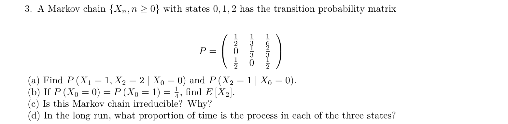

本题状态按 $(0,1,2)$ 排列。为便于在解析中查阅，一步矩阵为

$$
P=\begin{pmatrix}1/2&1/3&1/6\\0&1/3&2/3\\1/2&0&1/2\end{pmatrix}.
$$

#### (a) 指定路径概率与两步终点概率

##### 1. 题目在说什么

已知起点是 $X_0=0$。第一个要求同时满足 $X_1=1$、$X_2=2$，即完整指定路径 $0\to1\to2$；第二个只要求 $X_2=1$，中间 $X_1$ 可以是任何状态。$X_1,X_2$ 是随机状态，数字 0、1、2 是状态标签。两问都在起点固定的条件下计算，不需要初始分布。

##### 2. 第一反应

出现连续两个确定的状态，就沿路径乘一步概率；只给两步后的终点，就把所有可能的中间状态加起来。不要因为两个式子都有 $X_2$ 就使用同一个矩阵元素。

##### 3. 核心公式

链式条件概率和 Markov 性给出

$$
P(X_1=j,X_2=k\mid X_0=i)=p_{ij}p_{jk}.
$$

第二步的条件只需当前状态 $j$。若未指定 $j$，使用全概率：

$$
(P^2)_{ik}=\sum_{j=0}^2p_{ij}p_{jk}.
$$

本题第一式取 $(i,j,k)=(0,1,2)$，第二式取 $(i,k)=(0,1)$。

##### 4. 推导

指定路径的第一步概率 $p_{01}=1/3$，第二步 $p_{12}=2/3$，所以

$$
P(X_1=1,X_2=2\mid X_0=0)=\frac13\frac23=\boxed{\frac29}.
$$

两步到状态 1 的路径依中间点分成三个互斥事件：$0\to0\to1$、$0\to1\to1$、$0\to2\to1$。第三条最后一步不可能，因为 $p_{21}=0$：

$$
P(X_2=1\mid X_0=0)
=\frac12\frac13+\frac13\frac13+\frac16\,0
=\frac16+\frac19=\boxed{\frac5{18}}.
$$

##### 5. 考场写法

By the Markov property,

$$
P(X_1=1,X_2=2\mid X_0=0)=p_{01}p_{12}=\frac29.
$$

$$
P(X_2=1\mid X_0=0)=\sum_{j=0}^2p_{0j}p_{j1}
=\frac16+\frac19=\frac5{18}.
$$

##### 6. 易错点

- 把第一问写成 $(P^2)_{02}$ 会加入经过状态 0 或 2 的路径；本问要求中间状态恰为 1。
- 把第二问写成 $p_{01}^2=1/9$，只算了 $0\to1\to1$，漏掉 $0\to0\to1$。矩阵平方需要行乘列。

#### (b) 初始分布下的两步期望

##### 1. 题目在说什么

现在起点不固定，已知 $P(X_0=0)=P(X_0=1)=1/4$，剩余概率属于状态 2。所求 $E[X_2]$ 是状态数值 0、1、2 的加权平均，不是某一个状态的概率。矩阵描述条件转移，初始分布描述从哪些起点开始，二者缺一不可。

##### 2. 第一反应

先补齐初始分布，再求两步分布，最后按状态数值加权。期望中的 2 是时刻下标，$2P(X_2=2)$ 中的 2 才是状态取值。

##### 3. 核心公式

$$
\alpha^{(2)}=\alpha P^2,\qquad E[X_2]=\sum_{j=0}^2j\alpha^{(2)}_j.
$$

这里 $\alpha=(1/4,1/4,1/2)$；全概率将不同起点的两步概率混合起来。

##### 4. 推导

先由总概率为 1 得 $P(X_0=2)=1-1/4-1/4=1/2$。矩阵行乘列得到

$$
P^2=\begin{pmatrix}
1/3&5/18&7/18\\1/3&1/9&5/9\\1/2&1/6&1/3
\end{pmatrix}.
$$

例如 $(P^2)_{12}=0(1/6)+(1/3)(2/3)+(2/3)(1/2)=5/9$。逐列加权：

$$
\begin{aligned}
P(X_2=0)&=\tfrac14\tfrac13+\tfrac14\tfrac13+\tfrac12\tfrac12=\tfrac5{12},\\
P(X_2=1)&=\tfrac14\tfrac5{18}+\tfrac14\tfrac19+\tfrac12\tfrac16=\tfrac{13}{72},\\
P(X_2=2)&=\tfrac14\tfrac7{18}+\tfrac14\tfrac59+\tfrac12\tfrac13=\tfrac{29}{72}.
\end{aligned}
$$

三项相加为 $(30+13+29)/72=1$。因此

$$
E[X_2]=0\frac5{12}+1\frac{13}{72}+2\frac{29}{72}
=\boxed{\frac{71}{72}}.
$$

##### 5. 考场写法

The initial distribution is $\alpha=(1/4,1/4,1/2)$. Hence

$$
\alpha P^2=(30,13,29)/72,\qquad
E[X_2]=\frac{13+2\cdot29}{72}=\frac{71}{72}.
$$

##### 6. 易错点

- 把起点当成均匀分布：题面只给两个 $1/4$，第三个必须由归一化补成 $1/2$。
- 对分布概率直接取平均：期望应乘状态取值。概率和为 1 只能用于检查，不能作为期望答案。

#### (c) 不可约性

##### 1. 题目在说什么

问三个状态是否都属于同一个通信类。不可约不要求每对状态一步直达，而要求每个状态都能通过有限条正概率转移到任何其他状态。所求是结构判断，数值初始分布不影响它。

##### 2. 第一反应

找能经过所有状态的正概率环；一条覆盖全部状态的有向环足以证明双向可达。

##### 3. 核心公式

$i\to j$ 表示存在 $m\geq0$ 使 $(P^m)_{ij}>0$；$i\leftrightarrow j$ 要求 $i\to j$ 和 $j\to i$。沿一条每一步概率都正的路径，乘积为正，因此存在这种路径即可。

##### 4. 推导

矩阵中 $p_{01}=1/3>0$、$p_{12}=2/3>0$、$p_{20}=1/2>0$，所以有环 $0\to1\to2\to0$。从环上的任何点出发沿环前进，都能到达其他两点。例如 $1\to2\to0$ 的概率是 $(2/3)(1/2)=1/3>0$，弥补了 $p_{10}=0$。故所有状态相互通信，链不可约。

##### 5. 考场写法

Since $p_{01},p_{12},p_{20}>0$, the directed cycle $0\to1\to2\to0$ connects all states. Therefore all states communicate and the chain is irreducible.

##### 6. 易错点

- 看到 $p_{10}=0$ 就说可约：零的一步概率不排除两步或更多步到达。
- 只说明“0 能到所有点”还不够；必须说明其他点也能返回 0。覆盖所有点的有向环同时满足这两方面。

#### (d) 长期处于各状态的时间比例

##### 1. 题目在说什么

所求是很长一段轨迹中，访问状态 $j$ 的次数占总观察次数的比例。令 $\pi_j$ 表示这一比例的极限。本问不同于给定一个有限时刻的分布，初始的两个 $1/4$ 也不是长期比例。

##### 2. 第一反应

有限不可约性已经建立，长期访问比例可由唯一平稳分布计算。先解流入等于现有质量的列平衡，再解释它为什么回答时间比例。

##### 3. 核心公式

$$
\pi P=\pi,\qquad \sum_j\pi_j=1.
$$

有限不可约链的遍历结论给出

$$
\frac1K\sum_{n=0}^{K-1}\mathbf1_{\{X_n=j\}}\longrightarrow\pi_j
\quad\text{几乎必然}.
$$

指示量在状态为 $j$ 时取 1，否则取 0。若还要解释逐时刻概率收敛，本链的自环提供所需非周期性。

##### 4. 推导

写 $\pi=(a,b,c)$，分别对应 0、1、2。第 0 列与第 1 列给

$$
a=\frac12a+\frac12c,\qquad
b=\frac13a+\frac13b.
$$

移项得 $a=c$、$(2/3)b=(1/3)a$，即 $b=a/2$。归一化：

$$
a+\frac a2+a=1\quad\Rightarrow\quad
a=\frac25,\ b=\frac15,\ c=\frac25.
$$

第 2 列检查为 $(1/6)(2/5)+(2/3)(1/5)+(1/2)(2/5)=2/5$。因此长期比例为 $\boxed{(2/5,1/5,2/5)}$。另外 $p_{00}>0$，不可约性使全链周期为 1，所以从任一合法起点出发，逐时刻分布也收敛到这个向量。

##### 5. 考场写法

The finite irreducible chain has a unique stationary distribution. Solving

$$
a=\tfrac12a+\tfrac12c,\quad b=\tfrac13a+\tfrac13b,\quad a+b+c=1
$$

gives $\pi=(2/5,1/5,2/5)$. By the ergodic theorem, these are the long-run proportions of time in states 0, 1 and 2.

##### 6. 易错点

- 把某一行当平稳分布：一行只描述从指定起点走一步后的分布。
- 用“长期”一词混淆时间平均与分布极限；本题两者相同有理论条件，后面的四循环题会展示二者的区别。

### 02｜2022 Fall Q1：中间时刻的限制不能删

原题：midterm_2022_solutions.pdf，第 1 页，Q1(a)–(c)。

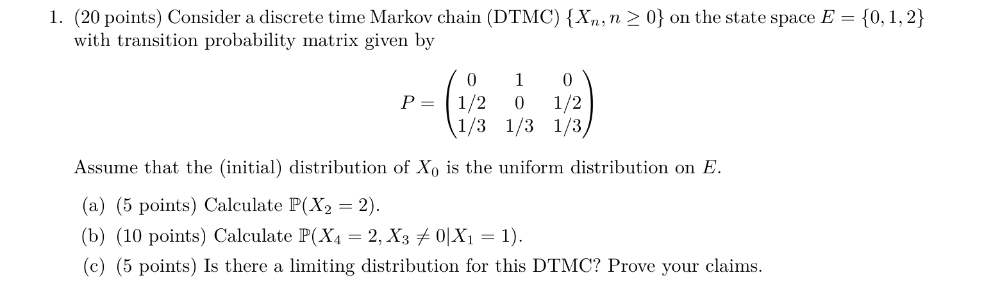

解析使用的状态顺序为 $(0,1,2)$：

$$
P=\begin{pmatrix}0&1&0\\1/2&0&1/2\\1/3&1/3&1/3\end{pmatrix},
\qquad\alpha=(1/3,1/3,1/3).
$$

#### (a) 均匀初始分布下两步到 2

##### 1. 题目在说什么

$X_0$ 在三个状态上均匀随机取值；要求的是没有固定起点的 $P(X_2=2)$。矩阵给定“从哪个状态出发”的条件概率，均匀分布要求对三种起点等权平均。时间从 0 到 2，恰为两步。

##### 2. 第一反应

先求 $P^2$ 的目标列，再由初始分布混合。这里只需要第 2 列，不必为了计算一个概率先把整个矩阵都乘完。

##### 3. 核心公式

$$
P(X_2=2)=\sum_{i=0}^2P(X_0=i)\sum_{k=0}^2p_{ik}p_{k2}.
$$

外层和枚举起点，内层和枚举第一步的中间状态；两层作用不同。

##### 4. 推导

三种起点的两步到 2 概率分别为

$$
\begin{aligned}
(P^2)_{02}&=0\cdot0+1\cdot\tfrac12+0\cdot\tfrac13=\tfrac12,\\
(P^2)_{12}&=\tfrac12\cdot0+0\cdot\tfrac12+\tfrac12\cdot\tfrac13=\tfrac16,\\
(P^2)_{22}&=\tfrac13\cdot0+\tfrac13\cdot\tfrac12+\tfrac13\cdot\tfrac13=\tfrac5{18}.
\end{aligned}
$$

将它们各乘 $1/3$：

$$
P(X_2=2)=\frac13\left(\frac12+\frac16+\frac5{18}\right)
=\frac13\frac{9+3+5}{18}=\boxed{\frac{17}{54}}.
$$

##### 5. 考场写法

By total probability and Chapman–Kolmogorov,

$$
P(X_2=2)=\sum_{i=0}^2\tfrac13(P^2)_{i2}
=\tfrac13(\tfrac12+\tfrac16+\tfrac5{18})=\tfrac{17}{54}.
$$

##### 6. 易错点

- 直接读 $p_{i2}$ 是一步概率，题目要求两步。
- 将均匀起点误认为“两步后仍均匀”。只有初始分布恰为平稳分布时才会保持不变，本题的均匀向量并不平稳。

#### (b) 给定时刻 1，兼有时刻 3、4 的条件

##### 1. 题目在说什么

已知 $X_1=1$，问时刻 3 不在 0 且时刻 4 在 2 的联合概率。竖线右边是已知条件，逗号两侧是同时要求的事件。$X_3\ne0$ 在本状态空间等价于 $X_3=1$ 或 $X_3=2$。原来的初始均匀分布在这个条件下不再需要。

##### 2. 第一反应

在限制出现的时刻 3 拆路径。从时刻 1 到 3 走两步，再从 3 到 4 走一步；不能把整个过程当成没有中间限制的三步终点题。

##### 3. 核心公式

$$
P(X_4=2,X_3\ne0\mid X_1=1)
=\sum_{k=1}^2(P^2)_{1k}p_{k2}.
$$

只枚举 $k=1,2$；Markov 性使最后一步条件于 $X_3=k$ 后不依赖 $X_1$。

##### 4. 推导

先算两步到允许中间状态的概率：

$$
(P^2)_{11}=\tfrac12\cdot1+0\cdot0+\tfrac12\cdot\tfrac13=\tfrac23,
\qquad
(P^2)_{12}=\tfrac12\cdot0+0\cdot\tfrac12+\tfrac12\cdot\tfrac13=\tfrac16.
$$

若时刻 3 在 1，最后到 2 的概率为 $1/2$；若在 2，则为 $1/3$。两个分支互斥，所以

$$
\frac23\frac12+\frac16\frac13
=\frac13+\frac1{18}=\boxed{\frac7{18}}.
$$

本题恰有 $p_{02}=0$，所以被排除的 $X_3=0$ 分支贡献为 0，数值上 $(P^3)_{12}$ 也等于 $7/18$。这只是本矩阵的特殊巧合，写出受限分解才能准确表达题目事件。

##### 5. 考场写法

Conditioning on $X_3\in\{1,2\}$,

$$
P(X_4=2,X_3\ne0\mid X_1=1)
=(P^2)_{11}p_{12}+(P^2)_{12}p_{22}
=\frac23\frac12+\frac16\frac13=\frac7{18}.
$$

##### 6. 易错点

- 从时刻 1 到 3 写成三步：步数应做时间差 $3-1=2$。
- 用 $(P^3)_{12}$ 却完全不处理 $X_3\ne0$：本题数值碰巧相同，换成 $p_{02}>0$ 的链就会多算路径。应先拆事件再计算。

#### (c) 极限分布是否存在

##### 1. 题目在说什么

题目问链运行很久后的分布是否趋于稳定，并要求证明。它不只是问能否找到一个满足 $\pi P=\pi$ 的向量；周期链也可能有平稳分布，却没有从固定起点出发的分布极限。

##### 2. 第一反应

依次检查有限、不可约、非周期。前两项保证唯一正常返平稳分布，第三项保证分布随时刻收敛。

##### 3. 核心公式

有限不可约非周期链满足

$$
\lim_{n\to\infty}(P^n)_{ij}=\pi_j
$$

对全部状态 $i,j$ 成立。自环 $p_{jj}>0$ 说明状态 $j$ 的周期为 1；不可约链的所有状态具有相同周期。

##### 4. 推导

正概率环 $0\to1\to2\to0$ 覆盖所有状态：概率分别为 $1,1/2,1/3$，所以链不可约。状态 2 有 $p_{22}=1/3>0$，可能一步返回，因此 $d(2)=1$；不可约性把周期 1 传给其余状态。状态空间只有三个元素，故上述收敛定理适用，极限分布存在且不依赖起点。

若想知道极限的具体数值，可设 $\pi=(a,b,c)$。由第 2 列得 $c=b/2+c/3$，即 $b=4c/3$；由第 0 列得 $a=b/2+c/3=c$。因此 $(10/3)c=1$，得到 $\pi=(3/10,2/5,3/10)$。这是帮助理解的补充，原问只要求存在性。

##### 5. 考场写法

All states communicate via $0\to1\to2\to0$. Since $p_{22}=1/3>0$, state 2 has period 1; irreducibility implies that all states have period 1. The chain is finite, irreducible and aperiodic, so it has a limiting distribution.

##### 6. 易错点

- 只写“非周期”而不给证据，遗漏题目明确要求的证明；指出具体自环即可。
- 只解 $\pi P=\pi$ 就声称极限存在，缺少非周期性。后面的确定四循环有平稳向量，固定起点分布仍振荡。

### 03｜2024 Fall Q1：运行最小值与吸收

原题：midterm2024-solution.pdf，第 1 页，Q1(a)–(h)。

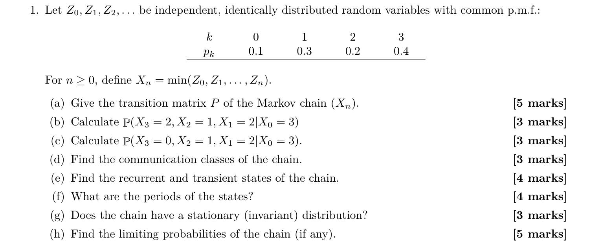

#### (a) 构造运行最小值的转移矩阵

##### 1. 题目在说什么

$Z_n$ 是每次新抽到的数，取值 0、1、2、3 的概率依次为 $0.1,0.3,0.2,0.4$，各次抽取独立同分布。$X_n$ 是从第 0 次到第 $n$ 次抽取的最小值，不是最新抽取值。问给定当前最小值后，下次最小值如何变化。状态空间按 $(0,1,2,3)$ 排列。

##### 2. 第一反应

先写更新关系 $X_{n+1}=\min(X_n,Z_{n+1})$。新的抽取与过去独立，因此知道当前最小值已经足够；而最小值只能不变或下降，所有向上转移为 0。

##### 3. 核心公式

给定 $X_n=i$，

$$
p_{ij}=\begin{cases}
P(Z_{n+1}=j),&j<i,\\
P(Z_{n+1}\geq i),&j=i,\\
0,&j>i.
\end{cases}
$$

留在 $i$ 并不要求新数等于 $i$；新数大于 $i$ 也不会改变最小值。

##### 4. 推导

从 0 出发永远是 0。从 1 出发，抽到 0 才降到 0，否则留在 1，所以该行为 $(0.1,0.9,0,0)$。从 2 出发，抽到 0、1 分别降到 0、1；抽到 2 或 3 留在 2，概率 $0.2+0.4=0.6$。从 3 出发，新最小值就是新抽取的数。故

$$
\boxed{P=\begin{pmatrix}
1&0&0&0\\0.1&0.9&0&0\\0.1&0.3&0.6&0\\0.1&0.3&0.2&0.4
\end{pmatrix}}.
$$

逐行求和均为 1；向上部分全为 0，与单调性一致。

##### 5. 考场写法

Since $X_{n+1}=\min(X_n,Z_{n+1})$ and $Z_{n+1}$ is independent of the past, the process is Markov. For $j<i$, $p_{ij}=P(Z=j)$; $p_{ii}=P(Z\geq i)$; for $j>i$, $p_{ij}=0$. Thus $P$ is the matrix displayed above.

##### 6. 易错点

- 将 $p_{22}$ 填成 $0.2$，漏掉新数为 3 时最小值仍是 2。
- 把每一行都填成 $Z$ 的分布：只有从最高状态 3 出发才这样，低状态不能向上移动。

#### (b) 包含向上一步的路径

##### 1. 题目在说什么

给定 $X_0=3$，要求时刻 1、2、3 依次为 2、1、2。虽然题面按 $X_3,X_2,X_1$ 的顺序写事件，实际路径必须按时间从小到大读成 $3\to2\to1\to2$。

##### 2. 第一反应

先看路径是否可能，再乘概率。运行最小值到 1 后不能重新变成 2。

##### 3. 核心公式

指定路径概率为各步转移概率之积：

$$
P(X_1=2,X_2=1,X_3=2\mid X_0=3)=p_{32}p_{21}p_{12}.
$$

任何一步不可能，整个交事件概率就是 0。

##### 4. 推导

前两步分别有概率 $p_{32}=0.2$ 和 $p_{21}=0.3$。第三步要求从 1 上升到 2，与最小值不增矛盾，所以 $p_{12}=0$。乘积为 $0.2\cdot0.3\cdot0=\boxed0$。

##### 5. 考场写法

$X_n$ is non-increasing, so the transition $1\to2$ is impossible. Hence the requested probability is $p_{32}p_{21}p_{12}=0$.

##### 6. 易错点

- 将最后一步的概率写成 $P(Z=2)=0.2$：新抽到 2 时旧最小值 1 仍保留。
- 只用起点、终点写 $(P^3)_{32}$，会把其他路径全部算入。

#### (c) 严格下降路径的概率

##### 1. 题目在说什么

仍从 3 出发，但三个观察时刻依次为 2、1、0。这次路径没有违反单调性；求的是这一条完整路径的概率，而非“三步内到过 0”的概率。

##### 2. 第一反应

路径合法后逐步相乘，每一步所需的新抽取值分别为 2、1、0。

##### 3. 核心公式

$$
P(X_1=2,X_2=1,X_3=0\mid X_0=3)=p_{32}p_{21}p_{10}.
$$

Markov 性保证每一步只使用当前最小值；新抽取的独立性也可直接给出三个指定抽取事件的乘积。

##### 4. 推导

从 3 到 2 必须抽到 2，概率 $0.2$；从 2 到 1 必须抽到 1，概率 $0.3$；从 1 到 0 必须抽到 0，概率 $0.1$。所以

$$
0.2\times0.3\times0.1=0.06\times0.1=\boxed{0.006}.
$$

##### 5. 考场写法

By the Markov property, the probability is

$$
p_{32}p_{21}p_{10}=0.2\cdot0.3\cdot0.1=0.006.
$$

##### 6. 易错点

- 把三步概率相加得到 0.6；交事件沿时间发生用乘法，互斥路径之间才用加法。
- 把到 0 的所有路径都枚举进来；题目还规定了两个中间状态。

#### (d) 通信类

##### 1. 题目在说什么

要将四个状态按双向可达性分组。向下可以直接到达，不意味着能够和较小状态相互通信。

##### 2. 第一反应

抓住“只降不升”。两个不同状态中，较小者不可能回到较大者，因此不能在同一通信类。

##### 3. 核心公式

通信要求 $i\to j$ 且 $j\to i$。由于 $X_{n+m}\leq X_n$，当 $j>i$ 时 $(P^m)_{ij}=0$，无论 $m$ 多大都不可能向上。

##### 4. 推导

例如 3 能到 2，但 2 不能到 3；2 能到 1，但 1 不能到 2。这个论证适用于任意不同状态。每个状态与自身通信，故通信类为

$$
\boxed{\{0\},\ \{1\},\ \{2\},\ \{3\}}.
$$

其中只有 $\{0\}$ 是闭类：从 0 不会离开，其他单点都有向下箭头。

##### 5. 考场写法

Since $X_n$ is non-increasing, no smaller state can reach a larger state. Thus no two distinct states communicate. The four communication classes are $\{0\},\{1\},\{2\},\{3\}$.

##### 6. 易错点

- 将所有状态归为一个类，因为“3 能到所有状态”；通信还要求反方向。
- 认为单点通信类一定吸收；$\{1\}$ 是单点类，却有概率 $0.1$ 离开。

#### (e) 常返与暂态

##### 1. 题目在说什么

从状态 $i$ 出发，问将来至少返回一次 $i$ 的概率是否为 1。常返判断的是最终返回，不是“有没有某个自环”。这里从正状态下降后永远不能回来。

##### 2. 第一反应

先找吸收状态，再用“永久离开”的正概率否定其他状态的常返性。

##### 3. 核心公式

令 $T_i^+=\inf\{n\geq1:X_n=i\}$，$f_i=P_i(T_i^+<\infty)$。$f_i=1$ 为常返，$f_i<1$ 为暂态。只降不升使正状态离开后不可能返回，因此本题 $f_i=p_{ii}$。

##### 4. 推导

从 0 出发下一步必为 0，故 $f_0=1$，返回时间恒为 1，0 正常返。从 1 出发，第一步留在 1 的概率为 $0.9$，若降到 0 则再也不能回 1，所以 $f_1=0.9<1$。同理 $f_2=0.6<1$、$f_3=0.4<1$。因此

$$
\boxed{0\text{ 常返； }1,2,3\text{ 暂态}}.
$$

##### 5. 考场写法

State 0 is absorbing and hence recurrent. For $i=1,2,3$, once the chain leaves $i$ it can never return, so $P_i(T_i^+<\infty)=p_{ii}<1$. Thus states 1, 2 and 3 are transient.

##### 6. 易错点

- “状态有限，所以全都常返”忽略了有限链可以有暂态状态；有限且闭的不可约类才全为正常返。
- “有自环，所以常返”混淆返回一次的可能性和最终返回概率为 1。

#### (f) 各状态的周期

##### 1. 题目在说什么

问每个状态可能返回的步数有没有固定的整除节奏。周期不等同于常返性；暂态状态也可以定义周期。

##### 2. 第一反应

先查对角线。只要一步有正概率回到自己，可能返回步数集合就包含 1。

##### 3. 核心公式

$$
d(i)=\gcd\{n\geq1:(P^n)_{ii}>0\}.
$$

集合含 1 时，最大公约数必为 1。

##### 4. 推导

四个自环概率依次为 $1,0.9,0.6,0.4$，全部正。对每个状态，$n=1$ 已是一个可能返回步数，所以 $d(i)=1$，即四个状态都非周期。这不改变 (e) 的暂态结论。

##### 5. 考场写法

Since $p_{ii}>0$ for every $i\in\{0,1,2,3\}$, each return-time set contains 1. Thus $d(0)=d(1)=d(2)=d(3)=1$.

##### 6. 易错点

- 先因链可约就放弃求周期；周期按状态定义，无须全链不可约。
- 用非周期推出常返：周期与最终是否返回是两个不同问题。

#### (g) 平稳分布

##### 1. 题目在说什么

问是否有一个概率向量，经过一步转移仍保持原样。此处要找 $\pi$，不是先默认四个状态平均分配，也不是要求从每个状态永远不移动。

##### 2. 第一反应

0 吸收，所以质量全放在 0 立即给出一个候选；再由平稳方程检查是否还有别的候选。

##### 3. 核心公式

$$
\pi P=\pi,\qquad \pi_i\geq0,\qquad\sum_i\pi_i=1.
$$

平稳方程按列写。这里从最高状态开始向下解，是因为矩阵没有向上转移，方程形成三角结构。

##### 4. 推导

写 $\pi=(a,b,c,d)$。状态 3 的平衡为 $d=0.4d$，所以 $0.6d=0$，得 $d=0$。状态 2 为 $c=0.6c+0.2d$，代入后 $0.4c=0$，得 $c=0$。状态 1 为 $b=0.9b+0.3c+0.3d$，故 $0.1b=0$，得 $b=0$。归一化得到 $a=1$。验证 $(1,0,0,0)P=(1,0,0,0)$，因此唯一平稳分布为

$$
\boxed{\pi=(1,0,0,0)}.
$$

##### 5. 考场写法

From $\pi P=\pi$, $\pi_3=0.4\pi_3$ implies $\pi_3=0$, then $\pi_2=0.6\pi_2$ implies $\pi_2=0$, and $\pi_1=0.9\pi_1$ implies $\pi_1=0$. Normalization gives the unique stationary distribution $(1,0,0,0)$.

##### 6. 易错点

- 因为链可约就说不存在平稳分布；有限链至少有一个平稳分布，本题还有唯一候选。
- 少写归一化会得到零向量，它满足线性方程但不是概率分布。

#### (h) 极限转移概率

##### 1. 题目在说什么

要求从任意起点 $i$ 出发，$P(X_n=j\mid X_0=i)$ 在 $n$ 很大时的极限。本问讨论真正的时间演化，不能仅用 (g) 的平稳性替代收敛证明。

##### 2. 第一反应

找一个必将发生的吸收触发事件：只要某次新抽取 $Z$ 为 0，运行最小值立即变成 0，之后不离开。

##### 3. 核心公式

从任意 $i>0$ 出发，

$$
P_i(X_n\ne0)=P(Z_1>0,\ldots,Z_n>0)=(0.9)^n.
$$

独立同分布用在连乘；给定 $X_0=i$ 不影响未来独立抽取。

##### 4. 推导

若起点正，前 $n$ 次更新仍未到 0，等价于每次新抽取都非零，每次概率 $0.9$，所以 $P_i(X_n=0)=1-0.9^n\to1$。对 $j=1,2,3$，

$$
0\leq P_i(X_n=j)\leq P_i(X_n\ne0)=0.9^n\to0.
$$

从 0 出发本来就恒在 0。四种起点结论相同，因此

$$
\boxed{\lim_{n\to\infty}P^n=
\begin{pmatrix}1&0&0&0\\1&0&0&0\\1&0&0&0\\1&0&0&0\end{pmatrix}}.
$$

##### 5. 考场写法

For $i>0$, $P_i(X_n\ne0)=0.9^n\to0$. Since state 0 is absorbing, for every $i$, $(P^n)_{i0}\to1$ and $(P^n)_{ij}\to0$ for $j=1,2,3$. Thus every row converges to $(1,0,0,0)$.

##### 6. 易错点

- 把“有限不可约非周期”当成存在极限的必要条件；本题可约，但直接吸收论证仍证明收敛。
- 把起点也算作未来新抽取，写成 $0.9^{n+1}$；固定 $X_0=i>0$ 后，未来更新只有 $Z_1,\ldots,Z_n$。

### 04｜2025 Spring Mid Q3：确定四循环

原题：midterm_sol_2025Spring.pdf，第 2–3 页，Problem 3(1)–(5)。

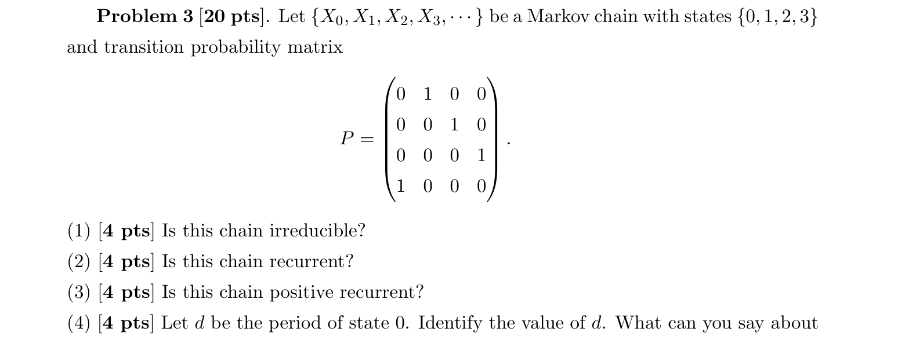

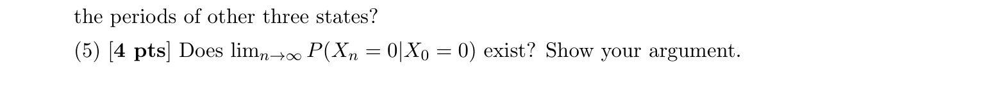

原矩阵描述 $0\to1\to2\to3\to0$，每条箭头概率为 1。原解文字的 $p_{31}=1$ 与矩阵不符，应为 $p_{30}=1$；题干矩阵本身无需修改。

#### (1) 是否不可约

##### 1. 题目在说什么

虽然每一步没有随机分支，仍是合法的 Markov 链：下一状态由当前状态唯一决定。问四个状态是否彼此可达，不是问每一步是否存在多个可能结果。

##### 2. 第一反应

沿四循环走一圈，检查有没有状态被隔开。确定转移和不可约性不冲突。

##### 3. 核心公式

若起点为 $i$，$m$ 步后状态是 $(i+m)\bmod4$。只需对每个目标 $j$ 找到一个非负步数 $m$ 使这个余数为 $j$，即可得到 $(P^m)_{ij}>0$。

##### 4. 推导

对不同的 $i,j$，在 $1,2,3$ 中总能选出 $m$ 使 $i+m\equiv j\pmod4$，该转移概率为 1。自己也在 4 步后必达。因此所有状态双向可达，只有一个通信类 $\{0,1,2,3\}$，链不可约。

##### 5. 考场写法

The chain follows the cycle $0\to1\to2\to3\to0$. Every state reaches every other state in at most three steps, so the chain is irreducible.

##### 6. 易错点

- 把转移矩阵中的大量 0 当成可约证据；必须检查多步路径。
- 因为过程确定而说不是 Markov 链；确定的更新也是只依赖当前状态的更新。

#### (2) 是否常返

##### 1. 题目在说什么

从任一状态出发，将来至少回到它一次的概率是否为 1。返回时刻从正整数开始算，不能用“起点已经是自己”来证明返回。

##### 2. 第一反应

找第一次绕完一圈的时刻；不是仅找一条有正概率返回的路径，而是确认这条路径必然发生。

##### 3. 核心公式

$T_i^+=\inf\{n\geq1:X_n=i\}$。常返条件为 $P_i(T_i^+<\infty)=1$。

##### 4. 推导

前三步分别处于另外三个状态，第四步回到出发状态，所有步骤概率均为 1。因此 $T_i^+=4$ 几乎必然，$P_i(T_i^+<\infty)=1$。四个状态全部常返。

##### 5. 考场写法

For every state $i$, the first return time is $T_i^+=4$ almost surely. Hence $P_i(T_i^+<\infty)=1$, and the chain is recurrent.

##### 6. 易错点

- 仅写 $(P^4)_{ii}>0$ 还不足以在一般链中证明常返；本题实际为 1，而且第四步必返。
- 把常返误写成“每一步都回到原状态”；它允许离开后再返回。

#### (3) 是否正常返

##### 1. 题目在说什么

在常返之外，再问平均第一次返回时间是否有限。正常返和零常返的区别由这个均值决定，不由周期是否为 1 决定。

##### 2. 第一反应

上问已经确定返回时间恒为 4，直接取期望即可；也可以使用有限不可约链正常返的结论。

##### 3. 核心公式

常返状态满足 $E_i[T_i^+]<\infty$ 时为正常返；若均值无穷则为零常返。

##### 4. 推导

因为 $T_i^+=4$ 几乎必然，

$$
E_i[T_i^+]=4<\infty.
$$

所以四个状态均正常返。这也与“有限状态空间 + 不可约”的一般结论一致。

##### 5. 考场写法

Since $E_i[T_i^+]=4<\infty$ for every $i$, all states are positive recurrent.

##### 6. 易错点

- 因周期为 4 而否定正常返；周期限制返回的步数，正常返限制平均返回长度。
- 在已经知道返回时间的情况下只写定理名称而不展示依据；$E_iT_i^+=4$ 是最直接证据。

#### (4) 状态 0 及其他状态的周期

##### 1. 题目在说什么

求所有可能返回步数的最大公约数。不是只问最短返回步数；这两个数在某些链中不同，本题恰好相同。

##### 2. 第一反应

列出全部可能返回步数：每完成一整圈才回原状态，故只能是 4 的正整数倍。

##### 3. 核心公式

$$
d(i)=\gcd\{m\geq1:(P^m)_{ii}>0\}.
$$

本题 $(P^m)_{ii}=1$ 当且仅当 $4\mid m$。

##### 4. 推导

状态 0 的返回步数集合为 $\{4,8,12,\ldots\}$，其最大公约数是 4，所以 $d(0)=4$。同一通信类周期相同；或直接从其他状态绕圈，也得到同样集合。因此所有状态周期为 $\boxed4$。

##### 5. 考场写法

$(P^m)_{00}>0$ exactly when $m\in\{4,8,12,\ldots\}$, so $d(0)=4$. By irreducibility, the other three states also have period 4.

##### 6. 易错点

- 把矩阵大小 4 当作周期的理由；许多四状态链有自环，周期为 1。
- 只找最短回路而不考虑所有返回步数；应明确本题全部返回长度都是 4 的倍数。

#### (5) 固定起点下概率极限是否存在

##### 1. 题目在说什么

固定 $X_0=0$，考察数列 $a_n=P(X_n=0\mid X_0=0)$ 是否有单一极限。这不是访问 0 的时间比例，也不是问有没有平稳分布。

##### 2. 第一反应

周期链先检查不同余数时刻的子序列。如果一个子序列恒为 1，另一个恒为 0，整个数列不可能收敛。

##### 3. 核心公式

收敛数列的所有子序列必须收敛到同一个极限。本题

$$
a_n=\mathbf1_{\{4\mid n\}}.
$$

##### 4. 推导

在 $n=4k$ 时，恰完成 $k$ 圈，所以 $a_{4k}=1$；在 $n=4k+1$ 时，必在状态 1，所以 $a_{4k+1}=0$。两条子序列极限分别为 1、0，故

$$
\boxed{\lim_{n\to\infty}P(X_n=0\mid X_0=0)\text{ 不存在}}.
$$

为区分概念：均匀向量 $\pi=(1/4,1/4,1/4,1/4)$ 满足 $\pi P=\pi$，每四步也恰访问各状态一次，所以时间平均为 $1/4$。这两点都不改变固定起点逐时刻概率振荡的事实。

##### 5. 考场写法

The limit does not exist because $(P^{4k})_{00}=1$ while $(P^{4k+1})_{00}=0$ for every $k$. These two subsequences have different limits.

##### 6. 易错点

- 把平稳概率 $1/4$ 当作本问极限；初始分布固定在 0，不是均匀平稳起点。
- 使用有限不可约链的收敛结论时漏掉非周期条件；本链的周期恰为 4。

### 05｜2022 Fall Q2：单向上升、闭类与累计停留

原题：midterm_2022_solutions.pdf，第 2 页，Q2(a)–(f)。

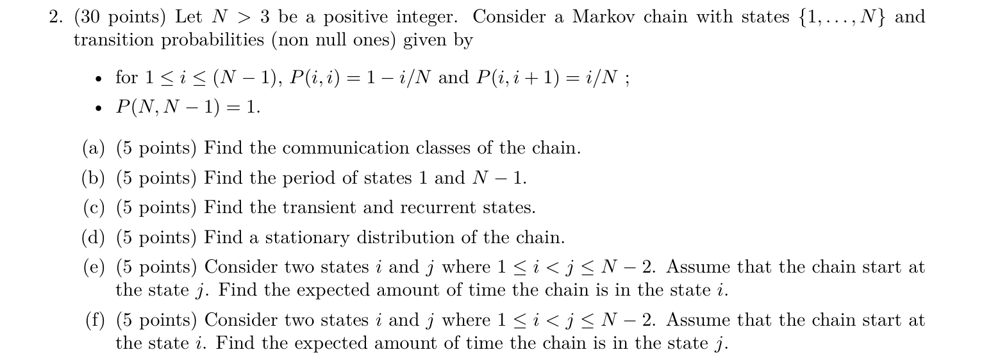

#### (a) 通信类

##### 1. 题目在说什么

$N>3$ 是固定整数，状态是 $1,\ldots,N$。对 $i<N$，下一步以 $1-i/N$ 留在 $i$，以 $i/N$ 上升到 $i+1$；从 $N$ 下一步必到 $N-1$。只列出的概率非零。问哪些状态双向可达。

##### 2. 第一反应

先画主要箭头 $1\to2\to\cdots\to N-1\leftrightarrow N$，再加自环。唯一向下箭头发生在最高两个状态之间，因此低状态没有返回通道。

##### 3. 核心公式

通信是双向可达的等价关系。若只存在 $i\to j$、不存在 $j\to i$，二者必须分在不同通信类；自环不会把不同类合并。

##### 4. 推导

对 $i\leq N-2$，一旦上升到 $i+1$，以后再也到不了 $i$。所以任意两个不同低状态不通信，低状态也不与最高两点通信。另一方面 $p_{N-1,N}=(N-1)/N>0$ 且 $p_{N,N-1}=1$，最高两点互相可达。故

$$
\boxed{\{1\},\ldots,\{N-2\},\{N-1,N\}}.
$$

最高两点组成唯一闭类，进去后不会流向更低状态。

##### 5. 考场写法

The communication classes are $\{i\}$ for $1\leq i\leq N-2$ and $\{N-1,N\}$. Lower states can only move upwards, whereas $N-1$ and $N$ communicate with each other.

##### 6. 易错点

- 将所有能向上到达的状态合成一类，漏掉通信要求返回。
- 把 $N$ 当吸收态；原题明确从 $N$ 必到 $N-1$。

#### (b) 状态 1 与 $N-1$ 的周期

##### 1. 题目在说什么

只要求两个指定状态的周期。状态 1 是低端单点类，$N-1$ 在最高闭类；虽然类别不同，两者都可能一步留在原处。

##### 2. 第一反应

计算两个自环概率，而不是看到最高两点来回移动就判断周期为 2。

##### 3. 核心公式

$p_{ii}>0$ 意味着 1 是可能返回步数，因而 $d(i)=1$。

##### 4. 推导

$$
p_{11}=1-\frac1N>0,\qquad
p_{N-1,N-1}=1-\frac{N-1}{N}=\frac1N>0.
$$

所以 $d(1)=d(N-1)=\boxed1$。作为联系，$N$ 自己没有自环，但它与 $N-1$ 通信，因此周期也为 1；例如从 $N$ 可在 2 步返回，也可经 $N-1$ 的自环在 3 步返回。

##### 5. 考场写法

Since $p_{11}=1-1/N>0$ and $p_{N-1,N-1}=1/N>0$, both states have period 1.

##### 6. 易错点

- 把 $N-1\leftrightarrow N$ 当作严格二循环，忘记 $N-1$ 可原地停留。
- 用不同通信类推出周期不同；不同类完全可以具有同样周期。

#### (c) 暂态与常返状态

##### 1. 题目在说什么

问从各状态出发最终是否必返回。低状态可能停留许多次，却仍有机会永久向上离开；最高两点则构成封闭有限系统。

##### 2. 第一反应

按闭类分类。有限闭不可约类中全部正常返；低端单点不是闭类，离开后永不返回。

##### 3. 核心公式

对低状态 $i\leq N-2$，第一次正时间返回发生当且仅当第一步自环，所以

$$
P_i(T_i^+<\infty)=1-\frac iN<1.
$$

最高闭类使用“有限不可约链正常返”的结论。

##### 4. 推导

低状态第一步以 $i/N>0$ 上升，而且不可逆转，故返回概率不足 1，为暂态。最高两点互相通信且所有转移都留在这两点内，组成有限闭不可约类，所以两点正常返。最终分类：

$$
\boxed{1,\ldots,N-2\text{ 暂态； }N-1,N\text{ 常返且正常返}}.
$$

##### 5. 考场写法

For $i\leq N-2$, the chain may leave $i$ upwards and can never return, so these states are transient. The class $\{N-1,N\}$ is finite, closed and irreducible, hence both states are positive recurrent.

##### 6. 易错点

- 认为在低状态可自环任意多次就常返；“任意多次有可能”不等于“最终返回概率为 1”。
- 把整个有限状态空间当作不可约类；本题全链可约，必须先识别闭类。

#### (d) 平稳分布

##### 1. 题目在说什么

找在一步转移后不变的概率分布。长期质量不能不断从低处向上流走而又无人补充，所以平稳质量只可能留在最高闭类。

##### 2. 第一反应

先消去暂态状态，再解两个未知数。这样避免写一个含 $N$ 个未知量的冗长系统。

##### 3. 核心公式

平稳方程 $\pi_j=\sum_i\pi_ip_{ij}$ 与归一化 $\sum_j\pi_j=1$。可从最低状态开始递推，直接证明低状态质量为 0。

##### 4. 推导

状态 1 的流入仅来自自己，所以 $\pi_1=(1-1/N)\pi_1$，得 $\pi_1=0$。对 $2\leq j\leq N-2$，

$$
\pi_j=(1-j/N)\pi_j+((j-1)/N)\pi_{j-1}.
$$

由前一项为 0，递推得 $\pi_j=0$。令 $a=\pi_{N-1}$、$b=\pi_N$，闭类内平衡为

$$
a=\frac aN+b,\qquad a+b=1.
$$

第一式得 $b=(N-1)a/N$，代入归一化：

$$
\left(1+\frac{N-1}{N}\right)a=1
\quad\Rightarrow\quad
\boxed{\pi_{N-1}=\frac N{2N-1},\quad
\pi_N=\frac{N-1}{2N-1}}.
$$

其他分量为 0。两项相加为 1，且最高状态每次只停一拍，$N-1$ 还会自环，所以 $a>b$ 合理。

##### 5. 考场写法

All transient-state stationary masses are zero. On $\{N-1,N\}$,

$$
a=a/N+b,\quad a+b=1.
$$

Thus $\pi_i=0$ for $i\leq N-2$, $\pi_{N-1}=N/(2N-1)$, and $\pi_N=(N-1)/(2N-1)$.

##### 6. 易错点

- 对最高两点直接各给 $1/2$；$N-1$ 有自环，停留次数比 $N$ 多。
- 用 $i/N$ 作为 $\pi_i$；转移概率描述一步动作，平稳质量描述时间分配。

#### (e) 从较高的 $j$ 出发，在较低的 $i$ 停留多久

##### 1. 题目在说什么

条件是 $1\leq i<j\leq N-2$，起点为 $j$，目标为 $i$。所求为整条未来轨迹在 $i$ 的累计观察次数的期望；不是首次到 $i$ 的等待时间。离散时刻下，每访问一次计一个单位。

##### 2. 第一反应

先检查目标能否到达。低端只上升，唯一向下动作发生在 $N,N-1$ 之间，无法返回到 $N-2$ 以下。

##### 3. 核心公式

累计占用量可写为

$$
V_i=\sum_{n=0}^{\infty}\mathbf1_{\{X_n=i\}}.
$$

如果每个时刻到目标的概率都为 0，则 $V_i=0$ 几乎必然，期望为 0。

##### 4. 推导

起点 $j>i$，未来在上升区只能维持或上升。即使进入最高两点，最小也只能回到 $N-1>i$。因此没有任何路径到达 $i$，每个指示量都等于 0，所以

$$
\boxed{E_j[V_i]=0}.
$$

原解 (e) 的文字把指标大小方向写反；正确依据是“从较高的 $j$ 不能回到较低的 $i$”。

##### 5. 考场写法

Starting from $j>i$ with $j\leq N-2$, state $i$ is unreachable. Hence $\sum_{n\geq0}\mathbf1_{\{X_n=i\}}=0$ almost surely and the expected time spent in $i$ is 0.

##### 6. 易错点

- 把“永远到不了”回答成无穷；无穷对应命中等待时间，累计停留恰为 0。
- 交换起点和目标的下标，会把本问误算成下一问的 $N/j$。

#### (f) 从较低的 $i$ 出发，在较高的 $j$ 累计停留多久

##### 1. 题目在说什么

仍有 $i<j\leq N-2$，这次起点是 $i$，目标是 $j$。定义 $s_{ij}=E_i[\sum_{n\geq0}\mathbf1_{\{X_n=j\}}]$。求累计占用次数，抵达目标前耗费的时间不计入这个量。

##### 2. 第一反应

先证明必达目标，再计算到了以后平均连续停留多少拍。也可写占用量的首步方程，只有当前已经在目标时才加 1。

##### 3. 核心公式

$$
s_{ij}=\mathbf1_{\{i=j\}}+\sum_kp_{ik}s_{kj}.
$$

在 $j$ 每步以 $j/N$ 离开，离开后不能返回，因此包含抵达时刻的停留长度为成功概率 $j/N$、取值从 1 开始的几何变量，均值为 $N/j$。

##### 4. 推导

从任一低状态 $k$ 永远不离开的概率为 $\lim_{m\to\infty}(1-k/N)^m=0$。从 $i$ 到 $j$ 只跨越有限个这样的状态，故到 $j$ 的概率为 1。到了 $j$，当前这一拍贡献 1；下一步若留在 $j$，未来期望仍为 $s_{jj}$，若上升则再也不占用 $j$：

$$
s_{jj}=1+(1-j/N)s_{jj}
\quad\Rightarrow\quad
\frac jN s_{jj}=1
\quad\Rightarrow\quad s_{jj}=\frac Nj.
$$

对 $i<j$，当前不在目标，不加 1：

$$
s_{ij}=(1-i/N)s_{ij}+(i/N)s_{i+1,j}
\quad\Rightarrow\quad s_{ij}=s_{i+1,j}.
$$

依次递推至 $j$，得到 $\boxed{s_{ij}=N/j}$。例如 $N=6,j=3$，每拍离开概率 $1/2$，累计停留均值为 2，不受更低起点影响。

##### 5. 考场写法

For $i<j$,

$$
s_{ij}=(1-i/N)s_{ij}+(i/N)s_{i+1,j},
\qquad
s_{jj}=1+(1-j/N)s_{jj}.
$$

Thus $s_{ij}=s_{i+1,j}=\cdots=s_{jj}=N/j$.

##### 6. 易错点

- 对 $i<j$ 的方程也加 1，会把抵达前的步数误算成在目标的占用。
- 使用从 0 开始的几何均值 $(1-p)/p$；本问抵达 $j$ 的这一拍也计数，正确均值是 $1/p$。

## 专题二：从业务规则建模，再求长期状态

矩阵并非题目总会给出。水库、保险、维修题都需要先确定观察时点，再将一天或一年的所有互斥情况分配到下一状态。最后的 Sample 题把平稳、可逆、非周期与合法条件放在一起比较。

### 06｜2023 Fall Q4：先入库、再截断、后放水

原题：2023_Fall_Midterm.pdf，第 2 页，Q4(a)–(e)。

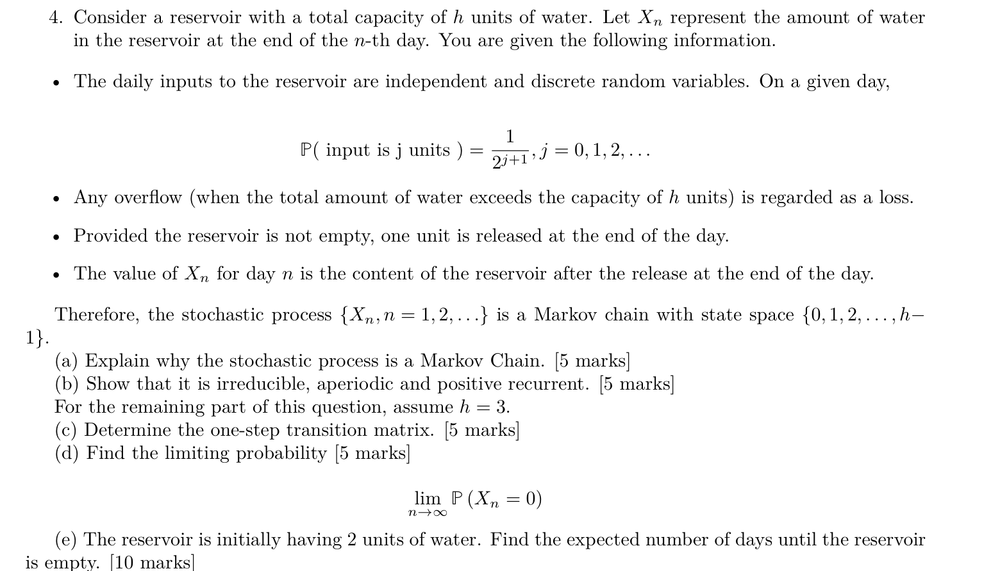

#### (a) 为什么是 Markov Chain

##### 1. 题目在说什么

水库容量是固定整数 $h$。每天入水量 $A_n$ 独立同分布，$P(A_n=j)=2^{-(j+1)}$，$j=0,1,\ldots$。超容量部分流失，日末若有水就放掉一单位。$X_n$ 是完成这次放水后的水量，因此最高状态是 $h-1$，不是 $h$。问过去水量历史能否通过当前 $X_n$ 概括。

##### 2. 第一反应

把一天的操作按顺序写成更新式。若下一状态是“当前状态 + 一个独立的新输入”的确定函数，便容易验证 Markov 性。

##### 3. 核心公式

$$
X_{n+1}=\max\{\min(h,X_n+A_{n+1})-1,\ 0\}.
$$

内层先限制容量，再减去放水，外层保证空库不会变负。新输入 $A_{n+1}$ 与截至当天的全部历史独立。

##### 4. 推导

给定全部历史 $X_0,\ldots,X_n$ 后，下一天仅由当前库存 $X_n$ 和新入水 $A_{n+1}$ 决定。由于后者的分布不受过去影响，下一状态的条件分布只依赖 $X_n$：

$$
P(X_{n+1}=j\mid X_n=i,X_{n-1},\ldots)
=P(X_{n+1}=j\mid X_n=i).
$$

更新规则每天相同，故是齐次 DTMC，状态空间为 $\{0,\ldots,h-1\}$。

##### 5. 考场写法

Let $A_{n+1}$ be the next day's input. Then

$$
X_{n+1}=\max\{\min(h,X_n+A_{n+1})-1,0\}.
$$

Because $A_{n+1}$ is independent of the past, the conditional distribution of $X_{n+1}$ depends only on $X_n$. Thus $\{X_n\}$ is a Markov chain.

##### 6. 易错点

- 只说时间、状态离散就宣布 Markov；还需要证明过去在给定当前后不再提供信息。
- 写成先放水后入水，或把状态定义为放水前库存，都会改变转移矩阵。

#### (b) 不可约、非周期、正常返

##### 1. 题目在说什么

这一问仍针对一般容量 $h$，尚未限定 $h=3$。要证明任意状态双向可达、返回步数最大公约数为 1，以及平均返回时间有限。

##### 2. 第一反应

用“无入水”逐天下降到 0，再从 0 用一次适当入水到任意目标；用 0 的自环证明非周期；最后用有限不可约性证明正常返。

##### 3. 核心公式

有限条正概率转移构成正概率路径。不可约类中周期相同。有限不可约链全部正常返，不必在一般 $h$ 下逐一算返回均值。

##### 4. 推导

从状态 $i>0$ 出发，连续 $i$ 天入水为 0 时，每天放水一单位，正好到 0，概率为 $(1/2)^i>0$。从 0 到目标 $j\leq h-1$，可令下一天入水恰为 $j+1$，此事件概率 $2^{-(j+2)}>0$；截断并放水后正好为 $j$。所以任意状态可经 0 到达其他状态，链不可约。

当 $h\geq2$，从 0 入水为 0 或 1 都仍到 0，故 $p_{00}=1/2+1/4=3/4>0$，状态 0 周期为 1，进而全链非周期。状态空间有限且不可约，故正常返。若 $h=1$，只有状态 0，一切结论直接成立。

##### 5. 考场写法

Any state reaches 0 through consecutive zero-input days, and 0 reaches any state $j$ through an input of $j+1$. Thus the chain is irreducible. State 0 has a positive self-loop, so the chain is aperiodic. Finiteness and irreducibility imply positive recurrence.

##### 6. 易错点

- 只写“存在路径”却不指出路径；无入水下降与一次入水上升提供了具体证明。
- 因某个状态没有明显自环而怀疑全链周期；不可约性允许只在一个状态找自环。

#### (c) 容量 $h=3$ 的矩阵

##### 1. 题目在说什么

现在日末状态只有 0、1、2。问每个当前库存下一天会变成哪种库存。容量仍是 3，状态最高为 2 是因为装满 3 后还要放掉 1。

##### 2. 第一反应

逐行固定当前库存，按入水量分组；达到容量后的所有大输入都必须合并进同一个尾概率。

##### 3. 核心公式

除更新式外，用几何级数求入水尾概率：

$$
P(A\geq k)=\sum_{j=k}^{\infty}2^{-(j+1)}
=\frac{2^{-(k+1)}}{1-1/2}=2^{-k}.
$$

因此 $P(A=0)=1/2$、$P(A=1)=1/4$、$P(A=2)=1/8$。

##### 4. 推导

从 0 出发：$A=0,1$ 都到 0；$A=2$ 到 1；$A\geq3$ 到 2，得 $(3/4,1/8,1/8)$。

从 1 出发：$A=0$ 时放水后到 0；$A=1$ 时到 1；$A\geq2$ 时到 2，得 $(1/2,1/4,1/4)$。

从 2 出发：$A=0$ 到 1；$A\geq1$ 都先装满再放水，到 2；不可能一天降到 0，得 $(0,1/2,1/2)$。所以

$$
\boxed{P=\begin{pmatrix}3/4&1/8&1/8\\1/2&1/4&1/4\\0&1/2&1/2\end{pmatrix}}.
$$

##### 5. 考场写法

For states $(0,1,2)$, the input partitions are $(A\leq1,A=2,A\geq3)$, $(A=0,A=1,A\geq2)$, and $(\varnothing,A=0,A\geq1)$, respectively. Hence $P$ is the matrix above.

##### 6. 易错点

- 从 0 入水 1 后写成状态 1，忘了日末还会放水。
- 将 $A\geq3$ 概率写成 $P(A=3)=1/16$；溢流使所有更大的输入也落入该转移。

#### (d) 空库的极限概率

##### 1. 题目在说什么

求很久以后某一天完成放水时水库为空的概率。无需固定初始库存，因为 (b) 已证明本有限链不可约、非周期。

##### 2. 第一反应

先解平稳分布的第 0 分量，再引用收敛条件，说明这个平稳分量确实是所求极限。

##### 3. 核心公式

$$
\pi P=\pi,\quad a+b+c=1,\qquad
\lim_{n\to\infty}P(X_n=0)=a,
$$

其中 $(a,b,c)$ 分别对应日末 0、1、2 单位水。最后一步依赖有限不可约非周期性。

##### 4. 推导

第 0 列给 $a=(3/4)a+(1/2)b$，移项得 $a=2b$。第 2 列给

$$
c=\frac18a+\frac14b+\frac12c
\quad\Rightarrow\quad
c=\frac14a+\frac12b=b.
$$

所以 $a+b+c=2b+b+b=4b=1$，得 $b=c=1/4$、$a=1/2$。因此

$$
\boxed{\lim_{n\to\infty}P(X_n=0)=\frac12}.
$$

##### 5. 考场写法

Solving $\pi P=\pi$ yields $a=2b$, $c=b$ and $a+b+c=1$, hence $\pi=(1/2,1/4,1/4)$. Since the chain is finite, irreducible and aperiodic, $P(X_n=0)\to\pi_0=1/2$.

##### 6. 易错点

- 把 $p_{00}=3/4$ 当极限概率；它只是在今天空库条件下明天仍空的概率。
- 省去适用条件就把所有平稳向量都解释成任意起点的分布极限。

#### (e) 从 2 单位水到首次空库的平均天数

##### 1. 题目在说什么

起点 $X_0=2$。定义首次命中空库的时间 $T_0=\inf\{n\geq0:X_n=0\}$，所求为 $m_2=E_2[T_0]$。因为起点非空，至少要观察后续天数；抵达空库后停止，不再等待它返回。

##### 2. 第一反应

命中时间用首步分析，每走一天加 1；目标状态的剩余等待为 0。和累计占用题相比，加 1 的位置正好不同。

##### 3. 核心公式

$$
m_0=0,\qquad m_i=1+\sum_jp_{ij}m_j\quad(i\ne0).
$$

常数 1 是已经过去的这一天，后面的 $m_j$ 是到达新状态后的剩余天数。

##### 4. 推导

从 1 出发可能到 0、1、2，从 2 出发只能到 1、2：

$$
m_1=1+\tfrac12m_0+\tfrac14m_1+\tfrac14m_2,\qquad
m_2=1+\tfrac12m_1+\tfrac12m_2.
$$

第二式移项得 $m_2-m_1=2$，即 $m_2=m_1+2$。第一式乘 4 并用 $m_0=0$：

$$
3m_1-m_2=4.
$$

代入 $m_2=m_1+2$，得到 $2m_1-2=4$，所以 $m_1=3$，进而 $m_2=\boxed5$ 天。回代第二式检查 $5=1+(1/2)3+(1/2)5$。

##### 5. 考场写法

Let $m_i=E_i[T_0]$, with $m_0=0$. First-step analysis gives

$$
m_1=1+\tfrac14m_1+\tfrac14m_2,\qquad
m_2=1+\tfrac12m_1+\tfrac12m_2.
$$

Thus $3m_1-m_2=4$ and $m_2-m_1=2$, yielding $m_1=3$, $m_2=5$. The expected number of days is 5.

##### 6. 易错点

- 给目标状态也写 $m_0=1+\cdots$，把命中时间改成返回时间。
- 把初始库存 2 当作“必定两天排空”；新入水会补充库存，平均时间是 5 天。

### 07｜2024 Fall Q2：无索赔折扣与长期平均保费

原题：midterm2024-solution.pdf，第 2 页，Q2(a)–(b)。

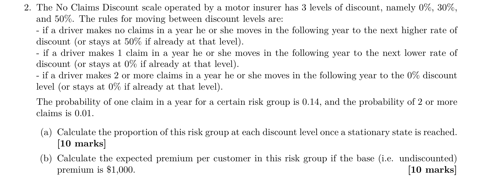

#### (a) 三个折扣档的长期比例

##### 1. 题目在说什么

每位客户当前折扣为 0%、30% 或 50%。无索赔时下一年升一档，最高档不再升；一次索赔降一档，最低档不再降；至少两次索赔直接回最低档。年度一次索赔概率 0.14，至少两次概率 0.01，所以无索赔概率为 $1-0.14-0.01=0.85$。题目要求固定风险组达到平稳状态后各档的客户比例。

按此年度模型，每年的转移使用同一组风险概率，未来索赔分类在给定当前状态后不依赖更早的折扣历史。用状态顺序 $(0\%,30\%,50\%)$，分别记为 0、1、2。

##### 2. 第一反应

按“无索赔、一次、至少两次”这三个互斥事件逐行建矩阵，然后解平稳分布。规则先决定下一档，索赔次数概率才填入对应格子。

##### 3. 核心公式

$$
p_{ij}=P(\text{下一年为档 }j\mid\text{当前为档 }i),\qquad
\pi P=\pi,\quad\sum_i\pi_i=1.
$$

本有限链不可约：可由无索赔连续上升，也可由索赔下降；端点有自环，因此达到稳定比例的解释适用。

##### 4. 推导

从 0% 档，任何索赔都留在 0%，总概率 $0.15$；无索赔到 30%，概率 $0.85$。从 30% 档，一次或多次索赔都到 0%，无索赔到 50%。从 50% 档，一次索赔到 30%，多次到 0%，无索赔仍在 50%。矩阵为

$$
P=\begin{pmatrix}
0.15&0.85&0\\0.15&0&0.85\\0.01&0.14&0.85
\end{pmatrix}.
$$

写 $\pi=(a,b,c)$。第 2 列得 $c=0.85b+0.85c$，所以 $0.15c=0.85b$，即 $c=17b/3$。第 0 列得 $a=0.15a+0.15b+0.01c$，故

$$
0.85a=\left(\frac3{20}+\frac1{100}\frac{17}{3}\right)b
=\frac{31}{150}b
\quad\Rightarrow\quad a=\frac{62}{255}b.
$$

由此 $a:b:c=62:255:1445$，三者权重和为 1762。归一化：

$$
\boxed{\pi=\frac1{1762}(62,255,1445)}
\approx(0.0351873,0.1447219,0.8200908).
$$

即约 3.52%、14.47%、82.01% 的客户分别在三档。无索赔概率高，所以最高折扣档占比大，符合规则直觉。

##### 5. 考场写法

For states $(0\%,30\%,50\%)$, the transition matrix is $P$ above. Let $\pi=(a,b,c)$. The stationary equations give $c=17b/3$, $a=62b/255$. With $a+b+c=1$,

$$
\pi=(62,255,1445)/1762.
$$

These are the stationary proportions of the risk group.

##### 6. 易错点

- 将从 50% 档的一次索赔也送回 0%；它只降一档到 30%。
- 在解平稳方程前就把状态比例四舍五入，容易改变最后保费的小数结果。保留分数到最终一步。

#### (b) 平均实付保费

##### 1. 题目在说什么

基准保费为 1000。客户在不同折扣档支付不同金额；求达到平稳状态后，随机选择一名客户的平均实付保费。30% 折扣表示减去 30%，所以支付 700；50% 折扣支付 500。

##### 2. 第一反应

将保费看作状态上的收益函数，使用上问平稳比例加权。三个档位不是等概率，也不能把折扣百分比直接当缴费比例。

##### 3. 核心公式

$$
E_\pi[r(X)]=\sum_i\pi_i r(i),\qquad
(r(0),r(1),r(2))=(1000,700,500).
$$

下标 $\pi$ 表示状态服从平稳分布；收益是当前档确定的实付金额。

##### 4. 推导

按三个客户群的占比求平均：

$$
\begin{aligned}
E[\text{premium}]
&=1000\frac{62}{1762}+700\frac{255}{1762}
+500\frac{1445}{1762}\\
&=\frac{62000+178500+722500}{1762}\\
&=\frac{963000}{1762}=\frac{481500}{881}
=\boxed{546.54\text{（约）}}.
\end{aligned}
$$

该结果位于最低保费 500 与最高保费 1000 之间，并接近 500，符合多数客户位于最高折扣档的结果。

##### 5. 考场写法

The premiums in the three states are 1000, 700 and 500. Therefore

$$
E[\text{premium}]=1000\pi_0+700\pi_1+500\pi_2
=\frac{481500}{881}\approx546.54.
$$

##### 6. 易错点

- 30% 折扣填成 300，那是优惠金额，不是实付保费。
- 对 1000、700、500 直接平均，忽略不同档的平稳比例。

### 08｜2025 Spring Mid Q4：两台机器、一个维修工

原题：midterm_sol_2025Spring.pdf，第 3 页，Problem 4(1)–(2)。

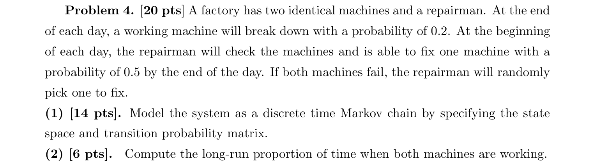

#### (1) 状态空间与一天的转移矩阵

##### 1. 题目在说什么

两台机器相同。每日开始时维修工检查，若有坏机只选一台修，到日末修好概率为 0.5；原本工作的机器在日末以概率 0.2 故障。若两台都坏，随机选哪台不影响“好机数量”这个状态。

采用原解所用的一天模型：在日末观察工作数；原工作机器的故障相互独立，也与所选维修的成功事件独立；本日新修好机器不再额外经历一次同日故障。题面未逐项写出这些独立与日内约定，矩阵需要它们，故在此明确。令 $X_n$ 为第 $n$ 日日末工作机器数，状态空间是 $\{0,1,2\}$。

##### 2. 第一反应

先固定观察时点，再分别枚举从 0、1、2 台工作出发的一天。不要用“坏机在当天被修复”的另一种事件顺序替换日初选择维修的规则。

##### 3. 核心公式

从 1 台工作出发，设 $B$ 表示原好机是否存活，$R$ 表示坏机是否修好：

$$
B\sim\operatorname{Bern}(0.8),\quad R\sim\operatorname{Bern}(0.5),
\qquad X_{n+1}=B+R.
$$

二者独立时，交事件概率相乘。从 2 台工作出发没有日初坏机可修，下一工作数为 $\operatorname{Bin}(2,0.8)$。

##### 4. 推导

从 0 出发，一天只能尝试修一台：维修失败到 0，成功到 1，概率分别为 0.5、0.5；不能到 2。

从 1 出发有四个互斥分支：原好机坏且维修失败，概率 $0.2\cdot0.5=0.1$，到 0；原好机存活且维修失败，概率 0.4，到 1；原好机坏但维修成功，概率 0.1，也到 1；两件有利事件同时发生，概率 0.4，到 2。合并得 $(0.1,0.5,0.4)$。

从 2 出发，两台均坏概率 $0.2^2=0.04$；恰一台存活概率 $2(0.8)(0.2)=0.32$；均存活概率 $0.8^2=0.64$。故

$$
\boxed{P=\begin{pmatrix}
0.5&0.5&0\\0.1&0.5&0.4\\0.04&0.32&0.64
\end{pmatrix}}.
$$

已知当前工作数后，下一天的故障与维修只依赖这个数量和新的随机事件，因此这个状态足以建立齐次 Markov 模型。

##### 5. 考场写法

Let $X_n$ be the number of working machines at the end of day $n$, with $S=\{0,1,2\}$. Under independent failures and repair success, using the daily convention above, the transition matrix is

$$
P=\begin{pmatrix}0.5&0.5&0\\0.1&0.5&0.4\\0.04&0.32&0.64\end{pmatrix}.
$$

In the middle row the two cases yielding one working machine have total probability $0.8(0.5)+0.2(0.5)=0.5$.

##### 6. 易错点

- 从 0 出发给 $p_{02}>0$：一个维修工每天只修一台。
- 从 2 出发立刻维修当天新坏的机器：日初两台都好，没有可选坏机。
- 从 1 到 1 只算原好机存活，漏掉“原好机坏、坏机却修好”的另一条分支。

#### (2) 长期两台都工作的比例

##### 1. 题目在说什么

所求为长期日末状态 $X_n=2$ 的时间比例。它受故障和维修的多日累积影响，不是只看“两台今天都没坏”的一步概率。

##### 2. 第一反应

求三状态链的平稳分布，取状态 2 的分量。状态有限、0 与 1 互达、1 与 2 互达，故不可约；对角线正也使逐时刻分布收敛。

##### 3. 核心公式

$$
\pi P=\pi,\quad \pi_0+\pi_1+\pi_2=1,\qquad
\text{长期两台工作比例}=\pi_2.
$$

用第 2 列和第 0 列即可求解，另一个平衡方程可作为检查。

##### 4. 推导

写 $\pi=(a,b,c)$。第 2 列给 $c=0.4b+0.64c$，所以 $0.36c=0.4b$，得 $b=0.9c$。第 0 列给 $a=0.5a+0.1b+0.04c$，所以

$$
0.5a=0.1(0.9c)+0.04c=0.13c,\qquad a=0.26c.
$$

归一化：

$$
(0.26+0.9+1)c=2.16c=1
\quad\Rightarrow\quad c=\frac{25}{54}.
$$

再得 $b=5/12$、$a=13/108$，三者为 $(13,45,50)/108$，和为 1。因此 $\boxed{25/54}$ 是长期两台均工作的比例。

##### 5. 考场写法

The chain is finite and irreducible. From $\pi P=\pi$,

$$
0.36c=0.4b,\quad0.5a=0.1b+0.04c,
$$

so $b=0.9c$, $a=0.26c$. Normalization gives $c=25/54$. By the ergodic theorem, the required long-run proportion is $25/54$.

##### 6. 易错点

- 回答 $0.64$，这是给定今天两台都好后明天仍都好的概率。
- 计算“工作机器的平均数量” $b+2c$；本问要的是两台都好的状态比例 $c$。

### 09｜2025 Spring Sample Q4：平稳、可逆与非法起点

原题：midterm_STA4001_sample1.pdf，第 5 页，Problem 4(1)–(4)。

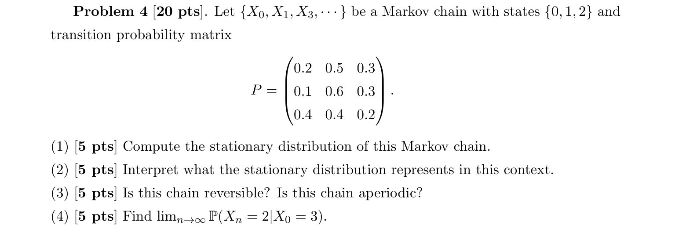

原题列出的过程下标漏写了 $X_2$，按通常的逐时刻 Markov 链记号理解即可。更关键的是最后问给出 $X_0=3$，而明确状态空间只有 $\{0,1,2\}$；这一问题在 (4) 单独处理。

#### (1) 求平稳分布

##### 1. 题目在说什么

一步矩阵每行描述当前在 0、1、2 时下一状态的概率。求一个概率向量 $\pi$，使按这个向量随机开始，一步以后仍具有同样分布。未知的是三个概率，不是矩阵中的 0.2、0.5 等既定参数。

##### 2. 第一反应

写列平衡并加总概率为 1。本题第 2 列前两项同为 0.3，可先用 $a+b=1-c$ 减少未知量。

##### 3. 核心公式

$$
\pi P=\pi,\qquad a+b+c=1,\quad\pi=(a,b,c).
$$

例如第 2 列表示下期到状态 2 的质量来自三种出发状态，而不是把矩阵第 2 行相加。

##### 4. 推导

原矩阵为

$$
P=\begin{pmatrix}0.2&0.5&0.3\\0.1&0.6&0.3\\0.4&0.4&0.2\end{pmatrix}.
$$

第 2 列给 $c=0.3a+0.3b+0.2c$。移项并用归一化：

$$
0.8c=0.3(1-c),\quad1.1c=0.3,\quad c=\frac3{11}.
$$

所以 $a+b=8/11$。第 0 列给 $0.8a=0.1b+0.4c$，代入 $b=8/11-a$：

$$
0.8a=\frac{0.8}{11}-0.1a+\frac{1.2}{11},
\quad0.9a=\frac2{11},
\quad a=\frac{20}{99}.
$$

于是 $b=72/99-20/99=52/99$，$c=27/99$，得到

$$
\boxed{\pi=(20,52,27)/99}.
$$

第 1 列检查为 $(10+31.2+10.8)/99=52/99$，与 $b$ 一致。

##### 5. 考场写法

Let $\pi=(a,b,c)$. Then $c=0.3(a+b)+0.2c$ and $a+b+c=1$ imply $c=3/11$. Substituting $b=8/11-a$ into $0.8a=0.1b+0.4c$ gives $a=20/99$, $b=52/99$. Hence $\pi=(20,52,27)/99$.

##### 6. 易错点

- 对向量写 $P\pi=\pi$ 却仍把 $\pi$ 当行向量，造成行列混乱；本讲义统一使用 $\pi P=\pi$。
- 省去归一化时得到无穷多个比例向量；概率向量必须总和为 1。

#### (2) 平稳分布表示什么

##### 1. 题目在说什么

要求解释上问向量的实际概率意义，而不是再解一遍方程。应区分“不变分布”的定义、单条轨迹的长期访问比例，以及固定起点的分布极限。

##### 2. 第一反应

先说定义，再检查这条链是否满足让长期解释成立的条件。矩阵全部元素正，因此任意两状态一步互达，各状态也有自环。

##### 3. 核心公式

$$
X_0\sim\pi\ \Rightarrow\ X_n\sim\pi\quad\forall n,
$$

以及有限不可约链的时间平均结论：

$$
\frac1K\sum_{n=0}^{K-1}\mathbf1_{\{X_n=j\}}\to\pi_j.
$$

本题另有非周期性，因此合法固定起点下 $(P^n)_{ij}\to\pi_j$。

##### 4. 推导

若初始状态按 $(20,52,27)/99$ 随机选择，一步分布是 $\pi P=\pi$，再转移仍为 $\pi$，由归纳每期分布都不变。若从单一合法状态开始，早期分布可以不同，但有限不可约性保证长期访问 0、1、2 的频率依次趋于 $20/99,52/99,27/99$。由于有自环，全链非周期，逐时刻状态概率也趋于这三个数。

这些比例不是某一次必有的状态，也不表示每 99 步恰好访问各状态 20、52、27 次；它们描述越来越长观察区间的比例极限。

##### 5. 考场写法

If $X_0\sim\pi$, then $X_n\sim\pi$ for all $n$. Moreover, the chain is finite and irreducible, so its long-run visiting proportions are $20/99,52/99,27/99$. Since the chain is also aperiodic, these are the limiting state probabilities from any legal initial state.

##### 6. 易错点

- 只解释成“下一步在各状态的概率”，遗漏平稳分布保持不变的特征。
- 认为只要有平稳分布，任意起点的逐时刻概率就收敛；四循环已经展示反例。

#### (3) 是否可逆，是否非周期

##### 1. 题目在说什么

可逆问的是平稳时两方向的概率流是否逐对相等；非周期问的是返回步数的最大公约数是否为 1。这两项需要分别判断，平稳性本身不能同时回答它们。

##### 2. 第一反应

否定可逆性只需找到一对违反详细平衡的状态；非周期性先看自环。这比把全部概率流都算完更直接。

##### 3. 核心公式

可逆性要求对所有 $i,j$，

$$
\pi_i p_{ij}=\pi_jp_{ji}.
$$

其中两边分别是平稳状态下一步沿 $i\to j$ 和 $j\to i$ 的联合概率。周期则由 $d(i)=\gcd\{n\geq1:(P^n)_{ii}>0\}$ 定义。

##### 4. 推导

取状态对 $(0,1)$：

$$
\pi_0p_{01}=\frac{20}{99}\frac12=\frac{50}{495},
\qquad
\pi_1p_{10}=\frac{52}{99}\frac1{10}=\frac{26}{495}.
$$

两者不等，详细平衡失败，故链不可逆。另一方面，$p_{00}=0.2,p_{11}=0.6,p_{22}=0.2$ 全部正，每个状态都允许一步返回，所以周期全为 1，链非周期。

##### 5. 考场写法

The chain is not reversible because

$$
\pi_0p_{01}=10/99\ne26/495=\pi_1p_{10}.
$$

It is aperiodic because all diagonal entries of $P$ are positive.

##### 6. 易错点

- 使用整体平衡 $\pi P=\pi$ 证明可逆；可逆要求每一对状态分别平衡，更强。
- 找到一对流相等就证明可逆不够；一对不等足以否定，全部对相等才足以证明。

#### (4) 原题的 $X_0=3$ 与条件修正

##### 1. 题目在说什么

原问为 $\lim_nP(X_n=2\mid X_0=3)$，但状态空间明确为 $\{0,1,2\}$。在给定模型内，不存在从状态 3 出发的转移行，事件 $X_0=3$ 也不可能发生。

##### 2. 第一反应

先检查条件是否合法。不能因为知道平稳概率就忽略一个不属于状态空间的起点。

##### 3. 核心公式

按合法起点定义的转移概率 $(P^n)_{i2}$，只对 $i\in\{0,1,2\}$ 有意义。本链满足有限不可约非周期条件，因此对这些合法 $i$，

$$
\lim_{n\to\infty}(P^n)_{i2}=\pi_2=\frac3{11}.
$$

这一定理没有为不存在的第 3 行补充定义。

##### 4. 推导

按原文，$X_0=3$ 不属于模型允许的初始条件，所以原条件概率无合法定义，不能直接给一个数。若题目原意是 $X_0=i$、$i\in\{0,1,2\}$，更正后所有起点的极限相同，等于上问的 $27/99=3/11$。原解未经说明直接给出 $27/99$，只能视为它意图回答更正后的题。

##### 5. 考场写法

As written, the question is not well-defined because $3\notin S=\{0,1,2\}$. If the initial state is corrected to any $i\in S$, then by finiteness, irreducibility and aperiodicity,

$$
\lim_{n\to\infty}P(X_n=2\mid X_0=i)=\pi_2=\frac3{11}.
$$

##### 6. 易错点

- 将状态标签解释成第几个状态，擅自把 3 当作状态 2；原题明确用的是标签 0、1、2。
- 只回答“错题”而不说明更正后怎样计算；先指出非法条件，再给带前提的结果，既忠实又有教学价值。

## 专题三：首步分析、条件命中与长期收益

“下一步之后还剩什么问题”是本专题的核心。命中概率只对未来成功概率加权；命中时间每走一步加 1；累计收益则加当前状态的收益。三个首步方程外形相近，但常数项含义不同。

### 10｜2024 Fall Q3：变概率赌徒与圆周覆盖

原题：midterm2024-solution.pdf，第 2–3 页，Q3(a)(i)–(iii) 与 Q3(b)。

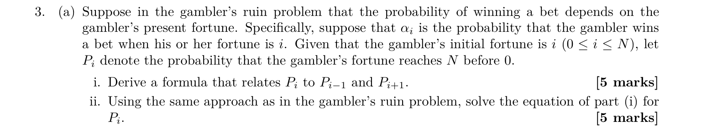

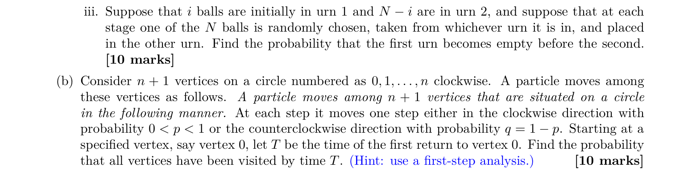

#### (a)(i) 财富依赖胜率的命中概率递推

##### 1. 题目在说什么

财富是状态 $i\in\{0,\ldots,N\}$。内部状态 $1\leq i\leq N-1$ 下，一局赢一单位的概率为 $\alpha_i$，输一单位的概率为 $1-\alpha_i$。原题 $P_i$ 表示“从 $i$ 出发先到 $N$ 而非 0”的概率，不是矩阵元素，也不是一步赢的概率。问 $P_i$ 与两个相邻状态的成功概率有什么关系。

##### 2. 第一反应

对第一局赢或输条件化。赢后问题变为“从 $i+1$ 出发”，输后变为“从 $i-1$ 出发”；成功判定本身没有经过一局就增加 1 的贡献。

##### 3. 核心公式

全概率公式给

$$
P_i=\alpha_iP_{i+1}+(1-\alpha_i)P_{i-1},
\quad1\leq i\leq N-1.
$$

边界 $P_0=0$、$P_N=1$：已破产时成功不可能，已到目标时成功已经发生。

##### 4. 推导

令 $A$ 为先到 $N$ 的事件。第一局结果是互斥且穷尽的两个分支。赢的分支概率 $\alpha_i$，在该分支下未来成功概率 $P_{i+1}$；输的分支概率 $1-\alpha_i$，未来成功概率 $P_{i-1}$。将两个“分支概率 × 分支内成功概率”相加，得到上述递推式。这里利用的是财富状态充分描述下一步胜率和未来规则。

##### 5. 考场写法

Conditioning on the first bet,

$$
P_i=\alpha_iP_{i+1}+(1-\alpha_i)P_{i-1},
\quad 1\leq i\leq N-1,
\qquad P_0=0,\ P_N=1.
$$

##### 6. 易错点

- 写成 $1+\alpha_iP_{i+1}+\cdots$，把概率当成等待时间；概率方程没有每局耗时项。
- 把 $\alpha_i$ 和 $P_i$ 混为一谈；前者是下一局胜率，后者是最终先达上边界的概率。

#### (a)(ii) 用相邻差求一般公式

##### 1. 题目在说什么

要解上问的递推系统，得到每个起点 $i$ 的成功概率。由于胜率随财富变化，不存在单一固定比率 $q/p$。下面乘积解采用标准内部条件 $0<\alpha_i<1$；若内部存在确定转移，应回到首步方程与可达性处理，不能使用除以零的表达式。

##### 2. 第一反应

将二阶递推改写成相邻差的一阶递推。固定胜率赌徒问题里的几何级数，在这里变成不同位置比率的连乘与求和。

##### 3. 核心公式

定义

$$
\Delta_i=P_i-P_{i-1},\qquad
\beta_i=\frac{1-\alpha_i}{\alpha_i},\qquad
c_0=1,\quad c_k=\prod_{\ell=1}^k\beta_\ell.
$$

$\Delta_i$ 是起点财富多一单位带来的成功概率增量；$c_k$ 是前 $k$ 个位置输赢比的累计乘积。

##### 4. 推导

将 $P_i=\alpha_iP_i+(1-\alpha_i)P_i$ 与首步方程比较，移项得

$$
\alpha_i(P_{i+1}-P_i)=(1-\alpha_i)(P_i-P_{i-1}),
\quad \Delta_{i+1}=\beta_i\Delta_i.
$$

从第一项逐步展开：

$$
\Delta_2=\beta_1\Delta_1,\quad
\Delta_3=\beta_2\beta_1\Delta_1,\quad
\Delta_i=c_{i-1}\Delta_1.
$$

因 $P_0=0$，$\Delta_1=P_1$。将差加回原概率：

$$
P_i=\sum_{\ell=1}^i\Delta_\ell
=P_1\sum_{k=0}^{i-1}c_k.
$$

再用上边界 $1=P_N=P_1\sum_{k=0}^{N-1}c_k$，消去 $P_1$：

$$
\boxed{P_i=\frac{\sum_{k=0}^{i-1}c_k}{\sum_{k=0}^{N-1}c_k}},
\qquad P_0=0.
$$

检查：若全部 $\alpha_i=p$，则 $c_k=(q/p)^k$，几何级数恢复固定胜率公式；若 $p=1/2$，各 $c_k=1$，得到 $P_i=i/N$。

##### 5. 考场写法

Set $\Delta_i=P_i-P_{i-1}$. The recurrence implies

$$
\Delta_{i+1}=\frac{1-\alpha_i}{\alpha_i}\Delta_i.
$$

With $c_0=1$, $c_k=\prod_{\ell=1}^k(1-\alpha_\ell)/\alpha_\ell$, we have $P_i=P_1\sum_{k=0}^{i-1}c_k$. Since $P_N=1$,

$$
P_i=\frac{\sum_{k=0}^{i-1}c_k}{\sum_{k=0}^{N-1}c_k}.
$$

##### 6. 易错点

- 分子求和到 $i$ 而不是 $i-1$：$P_i$ 只有 $i$ 个相邻差，从 $c_0$ 到 $c_{i-1}$。
- 将位置依赖的比率当成同一个 $r$，会把不同财富的胜率差异抹掉。
- 忽略 $\alpha_i=0$ 时不能除法；先检查内部胜率条件。

#### (a)(iii) 两个 urn 随机转移球

##### 1. 题目在说什么

总共 $N$ 个球，初始 urn 1 有 $i$ 个，urn 2 有 $N-i$ 个。每次从全部球中均匀选一个，并移到另一个 urn。所求是 urn 1 先空的概率，即其球数先达到 0，而不是先达到 $N$。两端分别表示 urn 1 空和 urn 2 空。

##### 2. 第一反应

用 urn 1 的球数作财富状态。选中 urn 2 的球才使 urn 1 增球；求出先达 $N$ 的概率后必须取补。

##### 3. 核心公式

内部状态下，

$$
\alpha_k=\frac{N-k}{N},\qquad
\beta_k=\frac{k}{N-k}.
$$

所有内部胜率均严格在 0、1 之间，上问乘积公式适用。由于有限区间内最终命中某一端点的概率为 1，先到 0 的概率为 $1-P_i$。

##### 4. 推导

当前 urn 1 有 $k$ 个球，选中 urn 2 的 $N-k$ 个球之一，才会把球转入 urn 1，因此增一的概率是 $(N-k)/N$。连乘权重为

$$
c_k=\prod_{\ell=1}^k\frac{\ell}{N-\ell}
=\frac{k!}{(N-1)(N-2)\cdots(N-k)}
=\frac{k!(N-1-k)!}{(N-1)!}
=\binom{N-1}{k}^{-1}.
$$

分母权重和记为 $D=\sum_{k=0}^{N-1}c_k$。上问给出先到 $N$ 的概率 $\sum_{k=0}^{i-1}c_k/D$；取补便剩下其余权重：

$$
\boxed{P(\text{urn 1 先空})
=\frac{\sum_{k=i}^{N-1}\binom{N-1}{k}^{-1}}
{\sum_{k=0}^{N-1}\binom{N-1}{k}^{-1}}}.
$$

边界 $i=0$ 时为 1，$i=N$ 时分子为空和，结果为 0。因 $c_k=c_{N-1-k}$，也可把答案写成同模型的 $P_{N-i}$，这解释了原解的表达式。

例如 $N=3,i=1$ 时，权重为 $1,1/2,1$，答案 $(1/2+1)/(1+1/2+1)=3/5$，不是公平随机游走的 $2/3$。

##### 5. 考场写法

Let the state be the number of balls in urn 1. Then $\alpha_k=(N-k)/N$, so

$$
c_k=\prod_{\ell=1}^k\frac{\ell}{N-\ell}
=\binom{N-1}{k}^{-1}.
$$

The required lower-boundary hitting probability is

$$
1-P_i=
\frac{\sum_{k=i}^{N-1}c_k}{\sum_{k=0}^{N-1}c_k}.
$$

##### 6. 易错点

- 写增球概率 $k/N$：那是选到 urn 1 的球、使 urn 1 减少的概率。
- 直接交出上问 $P_i$，回答了 urn 2 先空而非 urn 1 先空。
- 因为“球均匀抽取”就套公平游走；当两个 urn 球数不等时，增减概率不等。

#### (b) 首次回到 0 前访问全部圆周顶点

##### 1. 题目在说什么

圆上有 $n+1$ 个顶点，按顺时针标为 $0,1,\ldots,n$。每步顺时针概率为固定 $p$，逆时针概率 $q=1-p$，且 $0<p<1$。从 0 出发，$T$ 是第一次正时间返回 0 的时刻。目标是截至该时刻已经到过所有顶点，允许途中折返，但不能提前回到 0。

##### 2. 第一反应

按第一步方向分成两个情形，再把圆从 0 切开。最近邻移动保证：从一端走到另一端时，中间所有顶点一定被经过，因此覆盖问题可变成区间命中问题。

##### 3. 核心公式

设在区间 $\{0,\ldots,n\}$ 上，$h_i$ 为先到 $n$ 而非 0 的概率。固定胜率的公式为

$$
h_i=\frac{1-r^i}{1-r^n},\quad r=\frac qp,\quad p\ne q;
\qquad h_i=\frac in,\quad p=q=\frac12.
$$

设 $A$ 为全部顶点被访问的事件。第一步全概率给 $P(A)=pP(A\mid X_1=1)+qP(A\mid X_1=n)$。

##### 4. 推导

第一步顺时针到 1 后，若先回 0 则失败；若先到 $n$，沿途已经过 $1,\ldots,n$，目标已经完成，无须要求下一步立刻回 0。所以此条件成功概率是 $h_1$。

第一步逆时针到 $n$ 后，目标是在碰到 0 前先到 1。把区间 $\{1,\ldots,n,0\}$ 中末端 0 记为 $n+1$，再整体减 1，起点变为 $n-1$，目标变为下边界 0，上边界为 $n$。保持顺时针为向右，成功概率是 $1-h_{n-1}$。因此

$$
P(A)=ph_1+q(1-h_{n-1}).
$$

当 $p\ne q$，

$$
h_1=\frac{1-r}{1-r^n},\qquad
1-h_{n-1}=\frac{r^{n-1}-r^n}{1-r^n},
$$

合并得

$$
\boxed{P(A)=\frac{1-r}{1-r^n}(p+qr^{n-1})}.
$$

当 $p=q=1/2$，两个条件成功概率都为 $1/n$，所以 $\boxed{P(A)=1/n}$。例如三个顶点对应 $n=2$，公平时覆盖概率为 $1/2$，不是 $1/3$。

##### 5. 考场写法

Condition on the first step. The clockwise case requires hitting $n$ from 1 before 0, and the counterclockwise case requires hitting the opposite endpoint before returning. Thus

$$
P(A)=ph_1+q(1-h_{n-1})
=\begin{cases}
\dfrac{1-r}{1-r^n}(p+qr^{n-1}),&p\ne q,\\[4pt]
1/n,&p=q=1/2,
\end{cases}
\quad r=q/p.
$$

##### 6. 易错点

- 只算 $p^n+q^n$，要求一路不折返，漏掉先折返但仍未回 0 的成功路径。
- 将上边界写成 $n+1$；切开后从已走出的相邻点到远端的区间长度是 $n$。
- 将 $p=1/2$ 直接代入几何比公式得到 $0/0$，应使用公平情形公式。

### 11｜2025 Spring Mid Q5：条件命中与唯一闭类

原题：midterm_sol_2025Spring.pdf，第 4 页，Problem 5(1)–(3)。

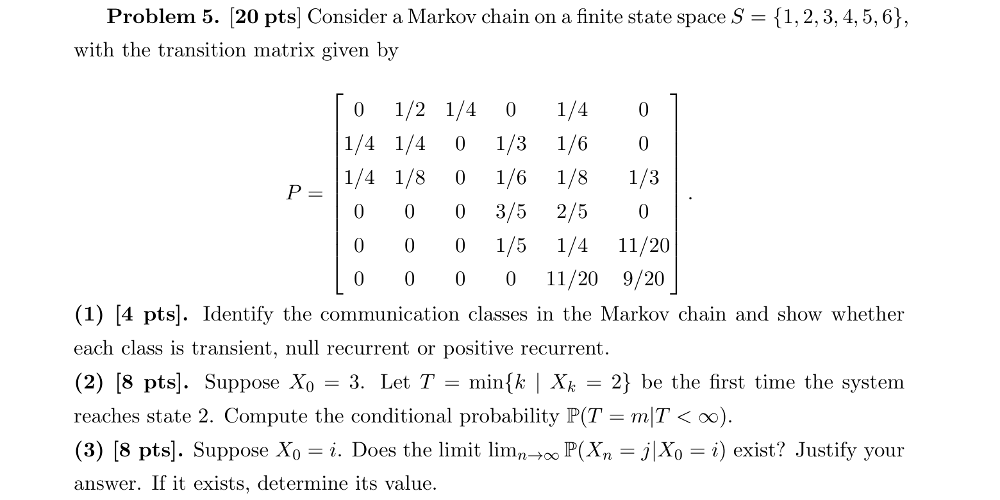

#### (1) 通信类及常返类型

##### 1. 题目在说什么

状态为 1 至 6，矩阵分成低状态与高状态两组。要求找通信类，并判断是暂态、零常返还是正常返。这里必须看两组之间的箭头方向，不能只看每组内部能否互通。

##### 2. 第一反应

先找不能流出的组。矩阵最后三行在前面三列全为 0，说明从 $\{4,5,6\}$ 无法回到 $\{1,2,3\}$。

##### 3. 核心公式

有限闭不可约类正常返；有限链的非闭通信类为暂态。也可用退出概率下界证明低状态最终流走。

##### 4. 推导

低组中 $1\leftrightarrow2$，又 $1\leftrightarrow3$，所以 $\{1,2,3\}$ 是一个通信类。它有通向高组的正概率，例如 $1\to5$，却没有反向路径，因此非闭。

高组中 $4\leftrightarrow5$、$5\leftrightarrow6$，所以 $\{4,5,6\}$ 互相通信；并且其所有转移留在组内，是闭类。低组三行的留组概率分别为 $3/4,1/2,3/8$，均不超过 $3/4$，故留在低组 $n$ 步的概率至多 $(3/4)^n\to0$。低组最终退出，属于暂态；高组有限闭不可约，全部正常返。没有零常返类。

##### 5. 考场写法

The classes are $\{1,2,3\}$ and $\{4,5,6\}$. The first is non-closed and transient. The second is closed, finite and irreducible, hence positive recurrent. There are no null recurrent classes.

##### 6. 易错点

- 只要组内互通就说正常返，遗漏该组能否流出。
- 在有限链中给一个常返类标为零常返；有限闭不可约类的平均返回时间有限。

#### (2) 从 3 首次命中 2，已知最终能命中的条件分布

##### 1. 题目在说什么

起点固定为 $X_0=3$，$T$ 是第一次进入状态 2 的时刻。若先进入高组，就永远到不了 2，因此 $T$ 可以为无穷。要求的是已经知道 $T<\infty$ 后，$T=m$ 的概率；不是未经条件化的首次命中概率。

##### 2. 第一反应

先枚举所有避开 2 且仍有机会命中它的路径。中途若进入高组必失败；在低组中避开 2，唯有 3 和 1 交替。因此先算奇偶两类未条件化概率，再归一化。

##### 3. 核心公式

$$
P(T=m\mid T<\infty)=\frac{P(T=m)}{P(T<\infty)}.
$$

因为 $T=m$ 已包含最终能命中的事件，分子不需要再与它取交。每个完整循环 $3\to1\to3$ 的概率为 $(1/4)(1/4)=1/16$。

##### 4. 推导

若 $m=2n-1$，先完成 $n-1$ 次循环，再从 3 到 2；末步概率为 $p_{32}=1/8$。若 $m=2n$，先完成同样数量循环，再从 $3\to1\to2$；末段概率为 $(1/4)(1/2)=1/8$。因此对 $n\geq1$，

$$
P(T=2n-1)=P(T=2n)=\frac18\left(\frac1{16}\right)^{n-1}.
$$

首两项对应 $3\to2$ 和 $3\to1\to2$，各为 $1/8$，可检查下标起点。把所有有限命中时刻相加：

$$
P(T<\infty)
=2\cdot\frac18\sum_{n=1}^{\infty}(1/16)^{n-1}
=\frac14\frac1{1-1/16}=\frac4{15}.
$$

未命中概率为 $11/15$。除以 $4/15$ 得

$$
\boxed{P(T=2n-1\mid T<\infty)
=P(T=2n\mid T<\infty)
=\frac{15}{32}\left(\frac1{16}\right)^{n-1}
=\frac{15}{2^{4n+1}}}.
$$

检查条件概率总和为 $2(15/32)/(1-1/16)=1$。原解示意路径错误地以 1 开始；这里全部以题定起点 3 开始，最终条件分布数值与其结论一致。

##### 5. 考场写法

Before first hitting 2, a successful path must alternate between 3 and 1. Thus, for $n\geq1$,

$$
P(T=2n-1)=P(T=2n)=\frac18(1/16)^{n-1}.
$$

Therefore $P(T<\infty)=4/15$, and

$$
P(T=2n-1\mid T<\infty)
=P(T=2n\mid T<\infty)=15/2^{4n+1}.
$$

##### 6. 易错点

- 将已经到过 2 后再返回的路径也算入；首次命中之前每个中间状态都必须不为 2。
- 假设有限链一定命中所有目标；目标 2 在暂态组，从高闭类永远无法返回。
- 不除以 $4/15$ 就作为条件分布，有限项总和只有 $4/15$。

#### (3) 从任意起点到任意终点的极限

##### 1. 题目在说什么

对任意 $i,j\in\{1,\ldots,6\}$，判断 $P(X_n=j\mid X_0=i)$ 的极限并给数值。全链可约，但只有一个闭类，且所有低起点最终都进入它，因此需要分析“进入哪个闭类”和“闭类内部怎样收敛”两件事。

##### 2. 第一反应

先求高闭类的平稳分布，再证明低组质量消失。本题闭类有自环，不会像四循环那样振荡。

##### 3. 核心公式

闭类按状态 $(4,5,6)$ 的矩阵为

$$
C=\begin{pmatrix}3/5&2/5&0\\1/5&1/4&11/20\\0&11/20&9/20\end{pmatrix}.
$$

解 $\rho C=\rho$。低组退出时间记为 $\tau$，有 $P_i(\tau>n)\leq(3/4)^n$。有限不可约非周期闭类内，从任何进入状态的分布都收敛到 $\rho$。

##### 4. 推导

令 $\rho=(a,b,c)$。第 4 状态的列平衡为 $a=(3/5)a+(1/5)b$，即 $b=2a$。第 6 状态为 $c=(11/20)b+(9/20)c$，即 $c=b$。归一化得 $a+2a+2a=1$，所以

$$
\rho=(1/5,2/5,2/5).
$$

闭类对角线正，故非周期。若起点低，$\tau$ 有限几乎必然；进入后无法离开。可以先取一个大时间 $K$，使尚未进入的概率很小；对于在 $K$ 之前已进入的路径，随 $n\to\infty$，闭类内运行时间趋于无穷，分布趋于同一 $\rho$。未进入部分的总质量又可由 $(3/4)^K$ 任意压小，因此起点低也得到同样极限。

于是对每个起点 $i$，

$$
\boxed{\lim_{n\to\infty}P(X_n=j\mid X_0=i)=
\begin{cases}
0,&j=1,2,3,\\
1/5,&j=4,\\
2/5,&j=5,6.
\end{cases}}
$$

##### 5. 考场写法

The unique closed class $\{4,5,6\}$ is irreducible and aperiodic. Solving $\rho C=\rho$ gives $\rho=(1/5,2/5,2/5)$. The probability of remaining in the transient class for $n$ steps is at most $(3/4)^n$, so every initial state reaches the closed class almost surely. Hence every row of $P^n$ converges to $(0,0,0,1/5,2/5,2/5)$.

##### 6. 易错点

- 看到可约就说极限依赖起点；若只有一个必达闭类且内部收敛，所有起点可以有共同极限。
- 只解闭类平稳分布，未解释为什么任意低起点最终都进入该类。
- 将状态 4、5、6 的平稳分量错误地放入向量前面三格；始终保留状态顺序。

### 12｜2022 Fall Q4：连续目标与累计目标

原题：midterm_2022_solutions.pdf，第 4 页，Q4(a)–(d)。

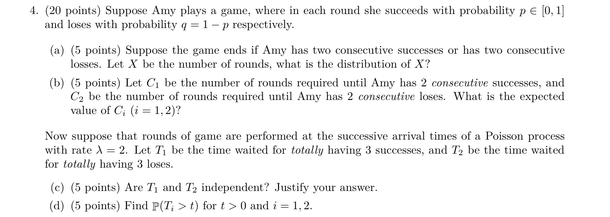

以下按本题独立重复游戏的通常设定：各局结果独立，成功概率恒为 $p$，失败概率 $q=1-p$；后半的结果标记还独立于 Poisson 开局时刻。原题由 (b) 到 (c) 明确从“连续两次”改成“累计三次”，两种目标使用不同方法。

#### (a) 首次连续两次相同结果的局数分布

##### 1. 题目在说什么

若出现相邻的 SS 或 FF 就停止，$X$ 是已经玩的总局数。第一次至少要玩两局，所以 $X$ 的取值从 2 开始。求每个可能局数的概率，不是只求连续两次成功，也不要求达到指定累计成功数。

##### 2. 第一反应

“还没停”意味着此前结果严格交替。先枚举交替序列的生存概率，再用相邻生存概率之差得到停止时刻分布，比直接逐一列所有停止序列清楚。

##### 3. 核心公式

$$
P(X=k)=P(X>k-1)-P(X>k).
$$

$X>m$ 表示前 $m$ 局都没有相邻相同结果。这里只可能是以 S 或 F 开头的两条交替序列，各局独立使其概率可以连乘。

##### 4. 推导

先设 $0<p<1$。长度为 $2n-1$ 的交替串，一条有 $n$ 次成功、$n-1$ 次失败，另一条相反。因此

$$
P(X>2n-1)=p^nq^{n-1}+q^np^{n-1}=(pq)^{n-1}.
$$

长度为 $2n$ 时，两条都含 $n$ 次成功与 $n$ 次失败，所以 $P(X>2n)=2(pq)^n$。于是

$$
\begin{aligned}
P(X=2n)
&=(pq)^{n-1}-2(pq)^n\\
&=(pq)^{n-1}(1-2pq)\\
&=\boxed{(pq)^{n-1}(p^2+q^2)}.
\end{aligned}
$$

再用 $P(X>2n+1)=(pq)^n$，得

$$
P(X=2n+1)=2(pq)^n-(pq)^n=\boxed{(pq)^n},
\qquad n\geq1.
$$

并有 $P(X=1)=0$。检查首项 $P(X=2)=p^2+q^2$ 正是 SS 或 FF；$P(X=3)=p^2q+q^2p=pq$。端点 $p=0$ 或 1 时前两局必同，$X=2$ 几乎必然。

##### 5. 考场写法

For $n\geq1$, strict alternation gives $P(X>2n-1)=(pq)^{n-1}$ and $P(X>2n)=2(pq)^n$. Hence

$$
P(X=2n)=(pq)^{n-1}(p^2+q^2),\qquad
P(X=2n+1)=(pq)^n.
$$

$P(X=1)=0$. If $p\in\{0,1\}$, $P(X=2)=1$.

##### 6. 易错点

- 只算 SS，不算 FF，改变了停止规则。
- 将 $X$ 当几何变量，忽略是否停止依赖上一次结果。
- 只给公平情形 $p=1/2$，没有回答原题的一般参数。

#### (b) 分别等待连续两次成功、连续两次失败的均值

##### 1. 题目在说什么

$C_1$ 是直到首次 SS 的总局数，遇到 FF 不停止；$C_2$ 是直到首次 FF 的总局数，遇到 SS 不停止。二者与上问的 $X$ 不同。现在分别求 $E[C_1]$、$E[C_2]$。

##### 2. 第一反应

连续成功目标需要记录末尾已经有几次连续成功。开始或刚失败时为状态 0，末尾恰有一次 S 时为状态 1，达成 SS 时为吸收目标 2。

##### 3. 核心公式

令 $m_0,m_1$ 为这两个未完成状态下的剩余局数期望。首步分析每玩一局加 1：

$$
m_0=1+pm_1+qm_0,\qquad
m_1=1+p\cdot0+qm_0.
$$

从状态 1 再成功即完成，剩余为 0；失败则连续记录清零，回到状态 0。

##### 4. 推导

由第一式，$pm_0=1+pm_1$。第二式给 $m_1=1+qm_0$，代入：

$$
pm_0=1+p(1+qm_0)=1+p+pqm_0.
$$

移项并用 $1-q=p$：

$$
p(1-q)m_0=p^2m_0=1+p,
\qquad E[C_1]=m_0=\boxed{\frac{1+p}{p^2}}.
$$

交换成功与失败，也就是交换 $p,q$，得 $\boxed{E[C_2]=(1+q)/q^2}$。当 $p=1/2$ 时两个均值都为 6；“两次累计成功”的均值却是 4，差异来自失败会清零连续记录。

若 $p=0$，$C_1=\infty$、$C_2=2$；若 $p=1$ 则相反。分母为零时应解释为永远无法完成，而不是写一个普通有限数。

##### 5. 考场写法

For two consecutive successes, first-step analysis gives

$$
m_0=1+pm_1+qm_0,\qquad m_1=1+qm_0.
$$

Thus $p^2m_0=1+p$, so $E[C_1]=(1+p)/p^2$ for $p>0$. By symmetry, $E[C_2]=(1+q)/q^2$ for $q>0$, with infinite expectation if the corresponding outcome has probability 0.

##### 6. 易错点

- 用 $2/p$，那是累计两次成功，允许两次成功之间夹失败。
- 从状态 1 失败后仍留在 1，忘记连续记录被重置。
- 将 (a) 的停止规则继续沿用到本问；本问等待 SS 时不会因 FF 停止。

#### (c) Poisson 开局时钟下，第三次成功与第三次失败的时刻是否独立

##### 1. 题目在说什么

游戏不再每单位离散时间必玩一局，而是在率 $\lambda=2$ 的 Poisson 到达时刻开局。$T_1$ 是累计第三次成功的时间，$T_2$ 是累计第三次失败的时间。问它们的联合分布是否分解成边际分布乘积。

##### 2. 第一反应

随机 Poisson 总流加独立成功/失败标记，使用 thinning。先建立独立的两种计数过程，再判断各等待时间只由哪一个过程决定。

##### 3. 核心公式

独立标记的 Poisson 分类定理给出

$$
N_S(t)\text{ 为率 }2p\text{ 的 Poisson 过程},\qquad
N_F(t)\text{ 为率 }2q\text{ 的 Poisson 过程},
$$

且两个过程独立。$T_1=\inf\{t:N_S(t)=3\}$，$T_2=\inf\{t:N_F(t)=3\}$。

##### 4. 推导

每次率 2 的开局点独立标成成功的概率为 $p$，所以成功点形成率 $2p$ 的流；其余形成率 $2q$ 的流。分类定理的结论不止是两个边际都为 Poisson，还包括两流独立。$T_1$ 只需知道成功流便可确定，$T_2$ 只需知道失败流便可确定；独立随机过程各自确定的随机量仍独立，所以 $\boxed{T_1,T_2\text{ 独立}}$。

单次游戏的成功、失败当然互斥，但不等于两个随机 Poisson 流不独立。若把总开局数固定，分类计数反而会受到总和约束；此题没有这种固定总数条件。

##### 5. 考场写法

By independent thinning, success and failure arrivals form independent Poisson processes with rates $2p$ and $2q$. Since $T_1$ and $T_2$ are the respective third arrival times of these independent processes, they are independent.

##### 6. 易错点

- 因“同一局不可能同时成功和失败”否定两流独立，混淆单点标记与完整随机流。
- 只证明两个时刻的边际分布是 Gamma 就断言独立；相同分布类型不能证明独立，依据是 thinning。

#### (d) 第三次事件尚未发生的尾概率

##### 1. 题目在说什么

对给定 $t>0$，求等到第三次成功或失败还要超过 $t$ 的概率。连续变量 $T_i$ 表示时间，离散变量 $N_S(t),N_F(t)$ 表示该时间内发生次数。

##### 2. 第一反应

把等待事件变成计数事件：第三次尚未发生，等价于到目前最多发生两次。

##### 3. 核心公式

$$
\{T_1>t\}=\{N_S(t)\leq2\},\qquad
P(\operatorname{Poi}(a)=k)=e^{-a}\frac{a^k}{k!}.
$$

本题成功流均值 $a=2pt$，失败流均值为 $2qt$。

##### 4. 推导

分别枚举计数 0、1、2：

$$
\begin{aligned}
P(T_1>t)
&=e^{-2pt}\left(\frac{(2pt)^0}{0!}
+\frac{(2pt)^1}{1!}+\frac{(2pt)^2}{2!}\right)\\
&=\boxed{e^{-2pt}(1+2pt+2p^2t^2)}.
\end{aligned}
$$

将 $p$ 换成 $q$，得到

$$
\boxed{P(T_2>t)=e^{-2qt}(1+2qt+2q^2t^2)}.
$$

当 $t=0$ 时尾概率为 1；正率下随 $t\to\infty$ 趋于 0。若某流率为 0，该流永远没有第三次到达，公式直接给尾概率 1。

##### 5. 考场写法

$$
P(T_1>t)=P(N_S(t)\leq2)
=e^{-2pt}\sum_{k=0}^2\frac{(2pt)^k}{k!},
$$

$$
P(T_2>t)=P(N_F(t)\leq2)
=e^{-2qt}\sum_{k=0}^2\frac{(2qt)^k}{k!}.
$$

##### 6. 易错点

- 将“第三次还没到”写成计数不超过 3；计数等于 3 时第三次已经发生。
- 使用总流率 2 而不是分类率 $2p,2q$。
- 在此又计算连续三次成功；原题明确用 totally，指累计。

### 13｜2025 Spring Sample Q5：重叠三元组的长期峰值比例

原题：midterm_STA4001_sample1.pdf，第 7 页，Problem 5(1)–(2)。

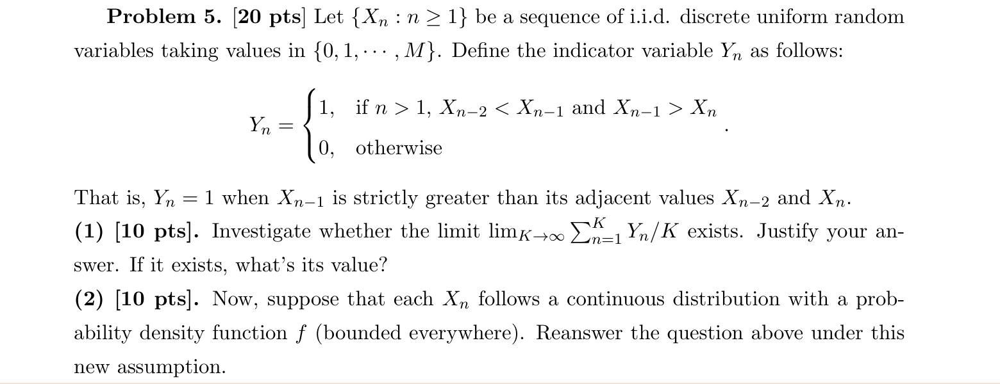

原题只定义 $X_n$、$n\geq1$，却在 $n=2$ 的 $Y_n$ 中用到 $X_0$。下面明确从 $n\geq3$ 使用三元组定义，并取 $Y_1=Y_2=0$；也可补定义独立的 $X_0$。任何有限个开头的改变对 $K^{-1}\sum_{n=1}^K Y_n$ 的影响至多为常数除以 $K$，不改变所问极限。

#### (1) 离散均匀样本的严格局部峰值

##### 1. 题目在说什么

$M$ 是固定非负整数，$X_n$ 独立同分布，在 $0,1,\ldots,M$ 上均匀取值。若连续三项的中间项严格大于两侧，就记 $Y_n=1$，否则记 0。问长样本中这种窗口所占比例是否有极限，以及极限数值。严格比较意味着平局不算峰。

##### 2. 第一反应

先处理相邻窗口重叠：$Y_n$ 与 $Y_{n+1}$ 共用两个 $X$，不能直接当 i.i.d. 使用大数定律。把完整三元组作为 Markov 状态，再将 $Y_n$ 看作状态上的收益；最后算一个典型三元组出现峰的概率。

##### 3. 核心公式

定义 $Z_n=(X_{n-2},X_{n-1},X_n)$。从 $(a,b,c)$ 下一步到 $(b,c,d)$，概率为 $1/(M+1)$。收益函数是 $r(a,b,c)=\mathbf1_{\{a<b,\ c<b\}}$。有限不可约链的收益平均收敛到平稳期望：

$$
\frac1K\sum r(Z_n)\longrightarrow E_\pi[r(Z)].
$$

本题三项独立均匀，其平稳三元组概率为 $(M+1)^{-3}$。

##### 4. 推导

先验证收敛依据。每个三元组只能依赖当前最后两项和一个独立新样本，因此是 Markov 链。连续追加任意指定的三个值，就可从任意三元组三步到任何目标三元组，概率 $(M+1)^{-3}>0$，故不可约。常数三元组 $(a,a,a)$ 有自环，链也非周期。均匀三元组分布是不变分布：目标 $(b,c,d)$ 有 $M+1$ 个前驱 $(a,b,c)$，流入质量之和为 $(M+1)(M+1)^{-3}(M+1)^{-1}=(M+1)^{-3}$。所以长期收益平均确实存在。

再算平稳期望。固定中间值为 $i$，发生概率 $1/(M+1)$；每侧比它小的候选值有 $i$ 个，即 $0,\ldots,i-1$。左右独立，所以两边都小的概率为 $[i/(M+1)]^2$：

$$
E[Y_n]=\frac1{(M+1)^3}\sum_{i=0}^M i^2.
$$

使用平方和 $\sum_{i=0}^M i^2=M(M+1)(2M+1)/6$，约去一个 $M+1$：

$$
\boxed{\frac1K\sum_{n=1}^K Y_n
\longrightarrow\frac{M(2M+1)}{6(M+1)^2}
\quad\text{几乎必然}}.
$$

检查 $M=0$ 时不可能严格峰，极限为 0；$M=1$ 时唯一峰型为 $(0,1,0)$，概率 $1/8$，与公式一致。

##### 5. 考场写法

Let $Z_n=(X_{n-2},X_{n-1},X_n)$. It is a finite irreducible Markov chain with uniform stationary distribution on triples. Therefore the ergodic theorem gives

$$
\frac1K\sum_{n=1}^K Y_n\to E[Y_3]
=\frac1{M+1}\sum_{i=0}^M\left(\frac i{M+1}\right)^2
=\frac{M(2M+1)}{6(M+1)^2}
\quad\text{a.s.}
$$

Finite initial-index corrections do not affect the limit.

##### 6. 易错点

- 因原始 $X_n$ 独立，就宣称相邻 $Y_n$ 独立；两个窗口共享原始数据。
- 直接给 $1/3$，忽略离散分布有平局；严格最大事件并不覆盖全部三元组。
- 只算 $E[Y_n]$ 而未证明样本平均收敛；需要遍历或大数论证。

#### (2) 改为连续分布后的极限

##### 1. 题目在说什么

原始序列仍独立同分布，但每项改为具有共同连续密度 $f$ 的随机变量，题目还给出 $f$ 处处有界。峰值仍是中间严格大于左右。连续性让相等概率为 0，却没有消除相邻窗口的重叠。

##### 2. 第一反应

先用三项对称性求峰值概率，再单独说明平均收敛。此时三元组状态空间不是有限集合，不能把上一问的“有限链”证明原封不动复制。

##### 3. 核心公式

设公共分布函数为 $F$。对中间值 $x$ 条件化：

$$
P(Y_n=1)=\int_{-\infty}^{\infty}f(x)F(x)^2\,dx.
$$

本式中 $F(x)$ 可用于严格小于，因为分布连续。补充验证方法：按下标模 3 分成三组，每一组依赖的三项窗口互不重叠，可分别用 i.i.d. 强大数定律。

##### 4. 推导

先求数值。三个独立同分布连续变量几乎必有唯一最大者，且三个位置对称，所以中间成为最大者的概率为 $1/3$。积分也可明确验证：

$$
\int f(x)F(x)^2\,dx
=\left[\frac{F(x)^3}{3}\right]_{-\infty}^{\infty}
=\frac{1^3-0^3}{3}=\frac13.
$$

再证明平均确实收敛。对 $r=0,1,2$，考虑下标 $n\geq3$ 且 $n\equiv r\pmod3$ 的窗口。例如 $Y_3,Y_6,Y_9,\ldots$ 分别依赖 $(X_1,X_2,X_3)$、$(X_4,X_5,X_6)$、$(X_7,X_8,X_9)$，窗口互不重叠，因此组内独立同分布。其他两组同理，各组样本平均都几乎必然趋于 $1/3$。

记截至 $K$ 的三组样本数为 $K_r$，则 $K_r/K\to1/3$。总体平均等于三组平均的加权和，加上有限开头项除以 $K$：

$$
\frac1K\sum_{n=1}^K Y_n
=\sum_{r=0}^2\frac{K_r}{K}
\left(\frac1{K_r}\sum_{\substack{3\leq n\leq K\\ n\equiv r\ (3)}}Y_n\right)
+o(1)
\longrightarrow\boxed{\frac13}.
$$

三组之间无需独立；只需每组各自的大数结论同时成立。密度有界比此处所需更强，连续且独立同分布已经保证无平局与上述论证。

##### 5. 考场写法

By symmetry and absence of ties, $E[Y_n]=1/3$. Split the sequence into the three subsequences with indices modulo 3. Within each subsequence, the defining triples are disjoint, so the indicators are i.i.d. and their averages converge almost surely to $1/3$. Each subsequence has asymptotic weight $1/3$; hence

$$
\frac1K\sum_{n=1}^K Y_n\longrightarrow\frac13\quad\text{a.s.}
$$

##### 6. 易错点

- 说连续版本“有限状态、不可约”，状态空间已变为连续三元组。
- 用对称性得出期望后就结束；对称性求数值，分组大数定律证明极限存在，两步缺一不可。
- 要求三组相互独立：它们之间可能共享数据，组内独立即足以分别应用强大数定律。

## 专题四：指数寿命、Poisson 分类与条件到达

先把系统工作条件翻译成最小或最大寿命，再处理指数竞争与无记忆性。Poisson 题先区分计数与等待时间，随后识别随机总和、分类流，以及“已知区间总数”产生的均匀到达位置。

### 14｜2025 Spring Sample Q1：全部工作与至少一个工作

原题：midterm_STA4001_sample1.pdf，第 1 页，Problem 1(1)–(2)。

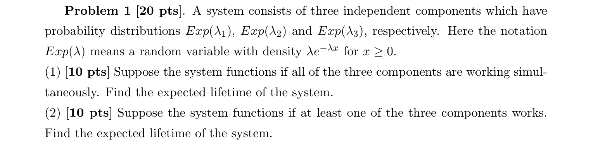

原题率参数印为 $\lambda_1,\lambda_2,\lambda_3$，解析沿用这些符号。令组件寿命为 $X_i\sim\operatorname{Exp}(\lambda_i)$，三者独立，$\lambda_i>0$。

#### (1) 三个组件必须同时工作

##### 1. 题目在说什么

任一组件失效就导致系统停止，因此系统寿命由最早坏掉的组件决定。所求为系统寿命的期望，不是三个组件各自平均寿命的和。率越大，组件平均寿命越短。

##### 2. 第一反应

“全部都要工作”对应最小寿命。系统能撑过时刻 $t$，当且仅当三个组件都撑过 $t$。

##### 3. 核心公式

$$
U=\min(X_1,X_2,X_3),\qquad
P(X_i>t)=e^{-\lambda_it}.
$$

独立性使三个存活事件的交概率变成乘积；非负变量的尾积分公式给 $E[U]=\int_0^\infty P(U>t)\,dt$。

##### 4. 推导

对 $t\geq0$，

$$
\begin{aligned}
P(U>t)
&=P(X_1>t,X_2>t,X_3>t)\\
&=\prod_{i=1}^3e^{-\lambda_it}
=e^{-(\lambda_1+\lambda_2+\lambda_3)t}.
\end{aligned}
$$

这正是率为 $\lambda_1+\lambda_2+\lambda_3$ 的指数尾概率。因此

$$
E[U]=\int_0^\infty e^{-(\lambda_1+\lambda_2+\lambda_3)t}\,dt
=\boxed{\frac1{\lambda_1+\lambda_2+\lambda_3}}.
$$

若三个率都为 $\lambda$，系统平均寿命 $1/(3\lambda)$ 小于单个组件的 $1/\lambda$，符合“任何一处坏都停机”的规则。

##### 5. 考场写法

Let $U=\min(X_1,X_2,X_3)$. Independence implies

$$
P(U>t)=\prod_{i=1}^3P(X_i>t)
=e^{-(\lambda_1+\lambda_2+\lambda_3)t}.
$$

Hence $U\sim\operatorname{Exp}(\lambda_1+\lambda_2+\lambda_3)$ and $E[U]=1/(\lambda_1+\lambda_2+\lambda_3)$.

##### 6. 易错点

- 把“全部组件同时工作”理解成要等所有组件都坏才停，颠倒了 min 与 max。
- 将寿命均值相加；系统并非依次使用三个组件，不能累加三个寿命。

#### (2) 至少一个组件工作即可

##### 1. 题目在说什么

系统只有在三个组件全部失效后才停止，因此由最后坏掉的组件决定寿命。组件从同一时刻开始工作，它们的工作时间彼此重叠，不能把最大值当作寿命之和。

##### 2. 第一反应

“至少一个还能工作”对应最大寿命。求最大值时，先写“全部已坏”的 CDF 更容易，再取补得到尾概率。

##### 3. 核心公式

$$
V=\max(X_1,X_2,X_3),\qquad
P(V\leq t)=\prod_{i=1}^3P(X_i\leq t)
=\prod_{i=1}^3(1-e^{-\lambda_it}).
$$

尾积分直接求期望，避免对乘积求导后再计算更长的密度积分。

##### 4. 推导

先展开乘积，再取补：

$$
\begin{aligned}
P(V>t)
&=e^{-\lambda_1t}+e^{-\lambda_2t}+e^{-\lambda_3t}\\
&\quad-e^{-(\lambda_1+\lambda_2)t}
-e^{-(\lambda_1+\lambda_3)t}
-e^{-(\lambda_2+\lambda_3)t}\\
&\quad+e^{-(\lambda_1+\lambda_2+\lambda_3)t}.
\end{aligned}
$$

三个单项代表各组件仍活，减去两两重复计数，再加回三重交集。每项积分使用 $\int_0^\infty e^{-at}\,dt=1/a$：

$$
\boxed{\begin{aligned}
E[V]&=\frac1{\lambda_1}+\frac1{\lambda_2}+\frac1{\lambda_3}\\
&\quad-\frac1{\lambda_1+\lambda_2}
-\frac1{\lambda_1+\lambda_3}
-\frac1{\lambda_2+\lambda_3}\\
&\quad+\frac1{\lambda_1+\lambda_2+\lambda_3}.
\end{aligned}}
$$

等率时结果为 $(3-3/2+1/3)/\lambda=11/(6\lambda)$，大于单个组件均值 $1/\lambda$、小于三个均值之和 $3/\lambda$。

##### 5. 考场写法

For $V=\max_iX_i$, independence gives $F_V(t)=\prod_i(1-e^{-\lambda_it})$. Therefore

$$
E[V]=\int_0^\infty(1-F_V(t))\,dt
=\sum_i\frac1{\lambda_i}
-\sum_{i<j}\frac1{\lambda_i+\lambda_j}
+\frac1{\lambda_1+\lambda_2+\lambda_3}.
$$

##### 6. 易错点

- 把最大值也写成率相加的指数分布；指数最小值闭合，最大值通常不是指数分布。
- 漏掉三重交集的正项，或把两两交集写成正号。先展开 CDF 再取补可减少符号错误。

### 15｜2024 Fall Q4：串行服务与指数剩余时间

原题：midterm2024-solution.pdf，第 3–4 页，Q4(a)–(c)。

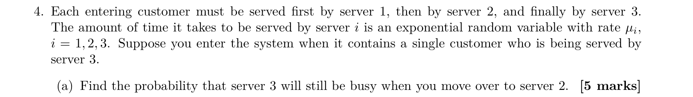

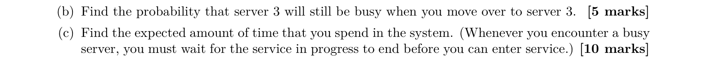

令 $V_i$ 为你在服务台 $i$ 自己的服务时间，率为 $\mu_i>0$；令 $R$ 为你进入系统时，旧顾客在台 3 的剩余服务时间。按题目通常的独立服务设定，自己的各段服务与旧服务独立。指数无记忆性给出 $R\sim\operatorname{Exp}(\mu_3)$。旧顾客的 $R$ 与你的 $V_3$ 必须区分。

#### (a) 你转到台 2 时，台 3 仍忙

##### 1. 题目在说什么

你到达时台 1、2 都空，所以立即在台 1 服务，经过随机时间 $V_1$ 后到台 2。台 3 仍忙，当且仅当旧顾客剩余服务 $R$ 超过 $V_1$。所求是比较两段独立指数时间的概率。

##### 2. 第一反应

这是指数竞争：看你的台 1 服务是否先结束。用“谁的率”判断分子，所求是 $V_1<R$，分子应为 $\mu_1$。

##### 3. 核心公式

独立指数变量 $A\sim\operatorname{Exp}(a)$、$B\sim\operatorname{Exp}(b)$ 满足

$$
P(A<B)=\int_0^\infty ae^{-at}e^{-bt}\,dt=\frac a{a+b}.
$$

本题对应 $A=V_1$、$B=R$。

##### 4. 推导

条件在自己的服务时间 $V_1=t$ 上，旧顾客仍忙的概率为 $e^{-\mu_3t}$。再对 $V_1$ 密度积分：

$$
P(R>V_1)
=\int_0^\infty e^{-\mu_3t}\mu_1e^{-\mu_1t}\,dt
=\mu_1\frac1{\mu_1+\mu_3}
=\boxed{\frac{\mu_1}{\mu_1+\mu_3}}.
$$

若 $\mu_1$ 很大，你很快到台 2，台 3 多半仍忙，结果趋近 1，分子方向正确。

##### 5. 考场写法

By memorylessness, $R\sim\operatorname{Exp}(\mu_3)$ independently of $V_1$. Thus

$$
P(\text{server 3 busy at server 2 arrival})
=P(V_1<R)=\frac{\mu_1}{\mu_1+\mu_3}.
$$

##### 6. 易错点

- 分子写成 $\mu_3$，算成旧顾客先完成的补事件。
- 使用旧顾客已服务时间去减平均服务时间；指数剩余时间由无记忆性重新得到同率指数分布。

#### (b) 你转到台 3 时，台 3 仍忙

##### 1. 题目在说什么

你完成台 1、2 的总服务时间是 $V_1+V_2$，到台 3 时旧顾客仍在，等价于 $R>V_1+V_2$。本问是从最初进入系统算的无条件概率，不是已知 (a) 事件后的条件概率。

##### 2. 第一反应

旧顾客要连续撑过你的两段服务。可以用无记忆性连续做两次竞争，也可以对两段时间条件化后将指数因子拆开。

##### 3. 核心公式

由 $R$ 的指数尾概率，

$$
P(R>V_1+V_2)=E[e^{-\mu_3(V_1+V_2)}].
$$

独立性使该期望分解成 $E[e^{-\mu_3V_1}]E[e^{-\mu_3V_2}]$。这不是说事件 $R>V_1$ 与 $R>V_2$ 独立。

##### 4. 推导

分别计算两个积分：

$$
E[e^{-\mu_3V_i}]
=\int_0^\infty \mu_i e^{-(\mu_i+\mu_3)t}\,dt
=\frac{\mu_i}{\mu_i+\mu_3},\quad i=1,2.
$$

因此

$$
\boxed{b:=P(R>V_1+V_2)
=\frac{\mu_1}{\mu_1+\mu_3}\frac{\mu_2}{\mu_2+\mu_3}}.
$$

从无记忆角度看，第一个因子是撑过台 1 的概率；在确已撑过的条件下，旧服务的剩余时间重新是率 $\mu_3$ 的指数，因此第二个因子才是继续撑过台 2 的条件概率。

##### 5. 考场写法

Using independence and the exponential survival function,

$$
P(R>V_1+V_2)
=E[e^{-\mu_3V_1}]E[e^{-\mu_3V_2}]
=\frac{\mu_1\mu_2}{(\mu_1+\mu_3)(\mu_2+\mu_3)}.
$$

##### 6. 易错点

- 只给第二个因子，忘记旧服务先要撑过台 1。
- 把 $V_1+V_2$ 当指数变量直接加率；指数时间之和通常不是指数分布。

#### (c) 你在系统中的平均总时间

##### 1. 题目在说什么

总逗留时间包括你自己的三段服务，以及到台 3 时可能发生的等待。台 1、2 初始空闲，无其他顾客阻挡；台 3 只有旧顾客。设 $S=V_1+V_2$，等待时间是 $W=(R-S)^+$，其中 $x^+=\max(x,0)$。

##### 2. 第一反应

把必发生的服务时间与有条件发生的额外等待分开。到台 3 仍忙的概率是上问 $b$；忙时平均还要等 $1/\mu_3$，所以无条件额外等待为 $b/\mu_3$。

##### 3. 核心公式

$$
L=V_1+V_2+W+V_3,\qquad
E[W]=P(R>S)\,E[R-S\mid R>S].
$$

指数无记忆性可在独立随机到达时间 $S$ 下使用：条件于 $S=s$ 且 $R>s$，$R-s$ 的尾概率仍是 $e^{-\mu_3u}$。

##### 4. 推导

先验证剩余等待：

$$
P(R-s>u\mid R>s)=\frac{e^{-\mu_3(s+u)}}{e^{-\mu_3s}}
=e^{-\mu_3u}.
$$

所以不论已耗去的 $s$ 是多少，只要到达时仍忙，剩余平均等待都是 $1/\mu_3$。对随机 $S$ 条件化仍得到同样均值，于是 $E[W]=b/\mu_3$。自己的服务均值分别为 $1/\mu_1,1/\mu_2,1/\mu_3$，相加：

$$
\boxed{E[L]=\frac1{\mu_1}+\frac1{\mu_2}+\frac1{\mu_3}
+\frac1{\mu_3}\frac{\mu_1\mu_2}{(\mu_1+\mu_3)(\mu_2+\mu_3)}}.
$$

若三率均为 1，$b=1/4$，总平均为 $3+1/4=3.25$。其中 3 是自己的服务，0.25 是被阻挡产生的平均等待。

##### 5. 考场写法

Let $W=(R-V_1-V_2)^+$. By memorylessness,

$$
E[W]=\frac{P(R>V_1+V_2)}{\mu_3}=\frac b{\mu_3}.
$$

Hence $E[L]=1/\mu_1+1/\mu_2+1/\mu_3+b/\mu_3$, where $b=\mu_1\mu_2/[(\mu_1+\mu_3)(\mu_2+\mu_3)]$.

##### 6. 易错点

- 不论是否遇忙都加 $1/\mu_3$，将额外等待多算成必然发生。
- 只加旧顾客的等待而漏掉你自己的台 3 服务；这两段时间分别属于不同顾客。
- 用 $E[R]-E[S]$ 代替 $E[(R-S)^+]$；负的差值应截为 0，不能移到期望外随意处理。

### 16｜2025 Spring Sample Q3：从条件二项到独立 Poisson 分类

原题：midterm_STA4001_sample1.pdf，第 3–4 页，Problem 3(1)–(3)。

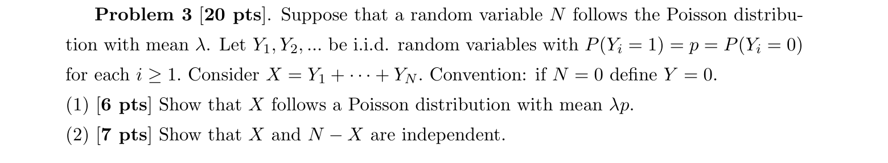

原题同时印 $P(Y_i=1)=p=P(Y_i=0)$，若 $Y_i$ 只取 0、1，两概率相加为 1 就强制 $p=1/2$。原解实际采用 $P(Y_i=1)=p$、$P(Y_i=0)=q=1-p$。空和约定又印成“$N=0$ 时定义 $Y=0$”，此处应为 $X=0$。

以下先明确采用原解意图中的 Bernoulli 模型，并补明标准 thinning 所需前提：整个标记序列 $\{Y_i\}$ 与 $N$ 独立。仅有 $Y_i$ 之间 i.i.d. 而没有与 $N$ 的独立性，不足以推出条件二项分布。若坚持原文两概率相等，只需在下列结果中取 $p=q=1/2$。

#### (1) 证明选中总数为 Poisson

##### 1. 题目在说什么

$N\sim\operatorname{Poi}(\lambda)$ 是随机总数量，$\lambda$ 是非负常数；每个对象独立以概率 $p$ 被选中，$Y_i$ 是对应的 0/1 标记。$X=\sum_{i=1}^N Y_i$ 为选中数量，$N=0$ 时为空和 0。要求证明完整分布 $X\sim\operatorname{Poi}(\lambda p)$，只算均值还不够。

##### 2. 第一反应

随机项数求和先条件于 $N$。给定总数 $n$，只剩固定 $n$ 次独立 Bernoulli 试验，选中数就是二项分布；再对 $N$ 的所有可能值混合。

##### 3. 核心公式

$$
X\mid N=n\sim\operatorname{Bin}(n,p),\qquad
P(X=k)=\sum_{n=k}^\infty P(X=k\mid N=n)P(N=n).
$$

下限是 $n=k$，因为总数小于选中数不可能。展开后用指数级数 $\sum_{m=0}^\infty a^m/m!=e^a$。

##### 4. 推导

对整数 $k\geq0$，

$$
\begin{aligned}
P(X=k)
&=\sum_{n=k}^\infty
\frac{n!}{k!(n-k)!}p^kq^{n-k}
e^{-\lambda}\frac{\lambda^n}{n!}\\
&=e^{-\lambda}\frac{(\lambda p)^k}{k!}
\sum_{n=k}^\infty\frac{(\lambda q)^{n-k}}{(n-k)!}.
\end{aligned}
$$

第二步约去 $n!$，并把 $\lambda^n$ 拆成 $\lambda^k\lambda^{n-k}$。令 $m=n-k$，求和从 0 开始：

$$
P(X=k)=e^{-\lambda}\frac{(\lambda p)^k}{k!}e^{\lambda q}
=\boxed{e^{-\lambda p}\frac{(\lambda p)^k}{k!}}.
$$

因为 $1-q=p$，指数化为 $-\lambda p$。这正是 Poisson pmf。$p=0$ 时 $X=0$；$p=1$ 时 $X=N$，都与结论相符。

##### 5. 考场写法

Under independent Bernoulli marking, $X\mid N=n\sim\operatorname{Bin}(n,p)$. For $k\geq0$,

$$
P(X=k)=\sum_{n=k}^\infty\binom nkp^kq^{n-k}e^{-\lambda}\frac{\lambda^n}{n!}
=e^{-\lambda p}\frac{(\lambda p)^k}{k!}.
$$

Hence $X\sim\operatorname{Poi}(\lambda p)$.

##### 6. 易错点

- 把无条件 $X$ 写成 $\operatorname{Bin}(\lambda,p)$；$\lambda$ 是随机总数的均值，不是固定试验次数。
- 只证明 $E[X]=\lambda p$ 就宣布分布为 Poisson；许多分布有相同均值。
- 不说明原题的两个 $p$ 及与 $N$ 的独立前提，得到的是未经说明的修正版证明。

#### (2) 证明选中数与剩余数独立

##### 1. 题目在说什么

剩余数为 $R=N-X$。要求的是无条件的 $X$ 与 $R$ 独立，不是给定总数后的独立。给定 $N=n$ 时两者之和固定，通常反而相互依赖。

##### 2. 第一反应

直接写联合 pmf。事件 $X=i,R=j$ 会强迫总数 $N=i+j$，因此只需一个条件二项概率乘一个 Poisson 总数概率。

##### 3. 核心公式

对任意非负整数 $i,j$，

$$
P(X=i,R=j)=P(X=i\mid N=i+j)P(N=i+j).
$$

若这个表达式对所有 $i,j$ 分解为 $f(i)g(j)$，且 $f,g$ 各为 pmf，则独立性得到证明。

##### 4. 推导

代入二项与 Poisson 概率：

$$
\begin{aligned}
P(X=i,R=j)
&=\binom{i+j}{i}p^iq^j e^{-\lambda}
\frac{\lambda^{i+j}}{(i+j)!}\\
&=e^{-\lambda}\frac{(\lambda p)^i}{i!}
\frac{(\lambda q)^j}{j!}.
\end{aligned}
$$

利用 $p+q=1$，把 $e^{-\lambda}$ 拆成 $e^{-\lambda p}e^{-\lambda q}$：

$$
P(X=i,R=j)
=\left[e^{-\lambda p}\frac{(\lambda p)^i}{i!}\right]
\left[e^{-\lambda q}\frac{(\lambda q)^j}{j!}\right].
$$

两括号各自是 Poisson pmf，故 $R\sim\operatorname{Poi}(\lambda q)$ 且 $\boxed{X\perp R}$。虽然 $N=X+R$，总数本身随机，允许两部分独立；给定总数后则不能照搬这个结论。

##### 5. 考场写法

For $i,j\geq0$,

$$
P(X=i,N-X=j)
=\binom{i+j}{i}p^iq^je^{-\lambda}\frac{\lambda^{i+j}}{(i+j)!}
=P(\operatorname{Poi}(\lambda p)=i)
P(\operatorname{Poi}(\lambda q)=j).
$$

Thus $X$ and $N-X$ are independent.

##### 6. 易错点

- 只看两边边际都为 Poisson 就说独立；必须使用联合分解或分类定理。
- 因“二者相加是 $N$”就否定独立，忘记 $N$ 不是固定常数。
- 将无条件独立继续用于给定 $N=n$ 的情形；条件化会改变依赖结构。

#### (3) 选中数与总数的 Pearson 相关系数

##### 1. 题目在说什么

现在比较的是 $X$ 和 $N$，而非上问的 $X$ 和 $N-X$。总数包含选中部分，通常正相关。Pearson 相关系数要求二者方差都正；先按 $\lambda>0,p>0$ 计算。

##### 2. 第一反应

利用 $N=X+R$ 与上问独立性可快速求协方差；也可以条件于 $N$ 算 $E[XN]$。两种方法能互相校验。

##### 3. 核心公式

$$
\operatorname{Corr}(X,N)=
\frac{\operatorname{Cov}(X,N)}
{\sqrt{\operatorname{Var}(X)\operatorname{Var}(N)}}.
$$

Poisson 均值等于方差，所以 $\operatorname{Var}(X)=\lambda p$、$\operatorname{Var}(N)=\lambda$。且 $E[X\mid N]=pN$。

##### 4. 推导

给定 $N$ 后，$N$ 是常数：

$$
E[XN]=E[N\,E[X\mid N]]=pE[N^2].
$$

由 $E[N^2]=\operatorname{Var}(N)+(E[N])^2=\lambda+\lambda^2$，

$$
\operatorname{Cov}(X,N)
=p(\lambda+\lambda^2)-(\lambda p)\lambda=\lambda p.
$$

也可写 $\operatorname{Cov}(X,X+R)=\operatorname{Var}(X)+\operatorname{Cov}(X,R)=\lambda p$。归一化得到

$$
\boxed{\operatorname{Corr}(X,N)=
\frac{\lambda p}{\sqrt{\lambda p\cdot\lambda}}=\sqrt p}.
$$

若 $p=1$，$X=N$，相关系数为 1；若 $\lambda=0$ 或 $p=0$，至少一个变量方差为 0，Pearson 相关系数无定义。按原题两概率相等的字面版本，非退化时 $p=1/2$，答案为 $1/\sqrt2$。

##### 5. 考场写法

Since $E[X\mid N]=pN$,

$$
\operatorname{Cov}(X,N)
=pE[N^2]-E[X]E[N]=p(\lambda^2+\lambda)-\lambda^2p
=\lambda p.
$$

Thus $\operatorname{Corr}(X,N)=\sqrt p$ for $\lambda>0,p>0$. It is undefined if either variance is zero.

##### 6. 易错点

- 将上问独立对象错记为 $X,N$，从而回答 0；独立的是选中数与剩余数。
- 把协方差 $\lambda p$ 直接称为相关系数，漏掉方差归一化。
- 在 $p=0$ 时给 0，忽略 Pearson 公式出现 $0/0$。

### 17｜2025 Spring Mid Q1：成组到达的复合 Poisson 随机和

原题：midterm_sol_2025Spring.pdf，第 1 页，Problem 1(1)–(2)。

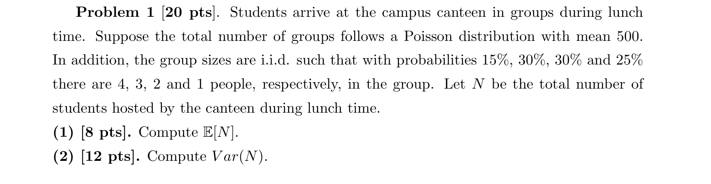

#### (1) 午餐总人数的期望

##### 1. 题目在说什么

原题 $N$ 是食堂接待的总学生数。为免与组数混淆，另设 $G$ 为到达组数，$G\sim\operatorname{Poi}(500)$；设 $X_i$ 为第 $i$ 组人数，取值 4、3、2、1 的概率分别为 0.15、0.30、0.30、0.25。于是 $N=\sum_{i=1}^G X_i$。按标准复合 Poisson 模型，组大小 i.i.d.，并与组数独立；原解的随机和计算也采用这个前提。500 是平均组数，组数本身并非恒等于 500。

##### 2. 第一反应

先条件于组数。固定 $G=g$ 后，$N$ 就是 $g$ 个相同分布组大小的和；再用塔式期望去掉条件。

##### 3. 核心公式

$$
E[N]=E[E[N\mid G]],\qquad E[N\mid G=g]=gE[X_1].
$$

组大小与 $G$ 的独立性保证给定组数后每组的平均大小仍与原来一样。

##### 4. 推导

先求一组的平均人数：

$$
\mu=E[X_1]=4(0.15)+3(0.30)+2(0.30)+1(0.25)
=0.60+0.90+0.60+0.25=2.35.
$$

给定 $G=g$，期望为 $2.35g$；再对随机组数取期望：

$$
E[N]=E[2.35G]=2.35E[G]=2.35(500)=\boxed{1175}.
$$

这表示重复许多个午餐时段后的平均总人数，不是每次恰有 1175 人。

##### 5. 考场写法

Let $G\sim\operatorname{Poi}(500)$ be the group count. The mean group size is $\mu=2.35$. Conditioning on $G$,

$$
E[N]=E[G\mu]=500(2.35)=1175.
$$

##### 6. 易错点

- 将“500 组”误读成“500 人”；组大小仍需参与计算。
- 直接把随机和改为恰 500 项，虽然本问期望数值碰巧一致，下一问方差会漏掉组数波动。

#### (2) 总人数的方差

##### 1. 题目在说什么

人数波动来自两层：给定组数时，各组大小不同；不同午餐时段，组数也不同。要求总方差，不能只累加固定 500 组的大小方差。

##### 2. 第一反应

使用全方差公式，分别算“固定组数内的随机性”和“条件均值随组数的随机性”。Poisson 特点是 $\operatorname{Var}(G)=E[G]=500$。

##### 3. 核心公式

$$
\operatorname{Var}(N)=E[\operatorname{Var}(N\mid G)]
+\operatorname{Var}(E[N\mid G]).
$$

组内独立时 $\operatorname{Var}(N\mid G)=G\sigma^2$，上问给 $E[N\mid G]=G\mu$，因此

$$
\operatorname{Var}(N)=E[G]\sigma^2+\mu^2\operatorname{Var}(G).
$$

##### 4. 推导

先算单组二阶矩：

$$
E[X_1^2]=16(0.15)+9(0.30)+4(0.30)+1(0.25)
=2.40+2.70+1.20+0.25=6.55.
$$

于是 $\sigma^2=6.55-2.35^2=6.55-5.5225=1.0275$。全方差两项分别为

$$
E[G\sigma^2]=500(1.0275)=513.75,
\qquad
\operatorname{Var}(G\mu)=2.35^2(500)=2761.25.
$$

相加：

$$
\boxed{\operatorname{Var}(N)=513.75+2761.25=3275}.
$$

也可在 Poisson 组数条件下合并为 $500(\sigma^2+\mu^2)=500E[X_1^2]=500(6.55)$。总人数并不服从普通 Poisson 分布：其均值 1175 与方差 3275 不相等。

##### 5. 考场写法

$E[X_1^2]=6.55$ and $\operatorname{Var}(X_1)=1.0275$. By total variance,

$$
\operatorname{Var}(N)
=500(1.0275)+(2.35)^2(500)=3275.
$$

Equivalently, the compound Poisson variance is $E[G]E[X_1^2]=500(6.55)$.

##### 6. 易错点

- 只算 $500\sigma^2=513.75$，漏掉组数变化造成的 2761.25。
- 认为组数 Poisson 就使人数也 Poisson；只有每组恰一人时才有这种直接关系。
- 将 $\operatorname{Var}(\mu G)$ 写成 $\mu\operatorname{Var}(G)$；常数缩放方差必须平方。

### 18｜2022 Fall Q3：礼品店的两类旅客

原题：midterm_2022_solutions.pdf，第 2–3 页，Q3(a)–(e)。

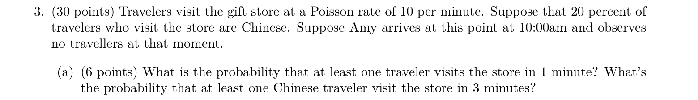

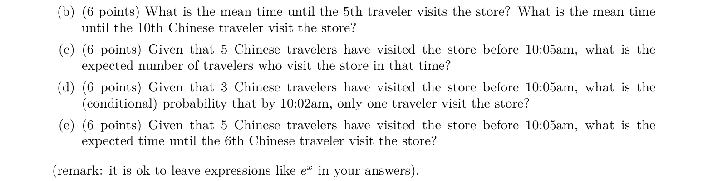

以 10:00 为 $t=0$，时间单位为分钟。令 $N(t)$ 为该时刻起累计进入的全部旅客数，$C(t)$ 为中国旅客数，$F(t)$ 为非中国旅客数，故 $N(t)=C(t)+F(t)$。按题目分类模型，每名旅客独立以 0.2 的概率属于中国旅客，标记独立于到达时刻。thinning 给 $C,F$ 为独立 Poisson 过程，率分别为 2、8 人/分钟。“给定五分钟内有 5 人”按本卷解答理解为恰有 5 人，不是至少 5 人。

#### (a) 至少一名全部旅客与至少一名中国旅客

##### 1. 题目在说什么

第一问看从 10:00 起一分钟内全部旅客至少一名，第二问看三分钟内中国旅客至少一名。计数过程和观察时长都不同：全部流率为 10，中国流率为 2。

##### 2. 第一反应

至少一次用补事件“零次”最快。先把率乘时间，形成对应区间的 Poisson 均值。

##### 3. 核心公式

$$
N(t)\sim\operatorname{Poi}(10t),\qquad C(t)\sim\operatorname{Poi}(2t),
\qquad P(\operatorname{Poi}(a)\geq1)=1-e^{-a}.
$$

$10,2$ 是每分钟的率；括号内 $t$ 才是持续的分钟数。

##### 4. 推导

一分钟全部人数 $N(1)$ 的均值为 $10(1)=10$，所以 $P(N(1)=0)=e^{-10}$，目标概率为 $\boxed{1-e^{-10}}$。

三分钟中国人数 $C(3)$ 的均值为 $(10)(0.2)(3)=6$，所以零人的概率为 $e^{-6}$，目标概率为 $\boxed{1-e^{-6}}$。

##### 5. 考场写法

$$
P(N(1)\geq1)=1-e^{-10},\qquad
P(C(3)\geq1)=1-e^{-2\cdot3}=1-e^{-6}.
$$

##### 6. 易错点

- 第二问只用均值 2，忘记观察了三分钟。
- 把“至少一人”算成“恰一人” $ae^{-a}$，漏掉两人及以上。

#### (b) 第五名全部旅客与第十名中国旅客的平均等待

##### 1. 题目在说什么

两问都从 10:00 开始计时，直到相应流的第 $k$ 次到达。需要的是时间期望，不是某段时间内人数的期望。设全部流第 5 次到达为 $S_5^{(N)}$，中国流第 10 次到达为 $S_{10}^{(C)}$。

##### 2. 第一反应

第 $k$ 次到达时间是 $k$ 个相邻指数间隔之和。分别用各流的率，平均等待为 $k/\lambda$。

##### 3. 核心公式

若率为 $\lambda$，相邻到达间隔 $W_i$ 独立同分布为 $\operatorname{Exp}(\lambda)$，所以

$$
S_k=\sum_{i=1}^kW_i,\qquad E[S_k]=\sum_{i=1}^k\frac1\lambda=\frac k\lambda.
$$

##### 4. 推导

全部流率 10，每个间隔均值 $1/10$ 分钟。前五个间隔相加：

$$
E[S_5^{(N)}]=5\frac1{10}=\boxed{\frac12\text{ 分钟}}.
$$

中国流率 2，每个间隔均值 $1/2$ 分钟。前十个间隔相加：

$$
E[S_{10}^{(C)}]=10\frac12=\boxed{5\text{ 分钟}}.
$$

##### 5. 考场写法

The mean $k$th arrival time of a rate-$\lambda$ Poisson process is $k/\lambda$. Thus $E[S_5^{(N)}]=5/10=0.5$ minutes and $E[S_{10}^{(C)}]=10/2=5$ minutes.

##### 6. 易错点

- 第十名中国旅客仍除以总率 10，忽略分类。
- 使用 $1/(k\lambda)$，那是 $k$ 个独立指数竞争的最小值均值，不是 $k$ 次累计等待。

#### (c) 给定中国人数，求五分钟全部人数的条件期望

##### 1. 题目在说什么

已知 $C(5)=5$，求 $E[N(5)\mid C(5)=5]$。中国人数已经固定为 5，非中国人数仍随机。原本五分钟中国人数的均值是 10，但给定事件后不能继续使用这个无条件均值。

##### 2. 第一反应

总人数拆成已知的中国人数与独立的非中国人数。只更新被条件固定的那部分。

##### 3. 核心公式

$$
E[N(5)\mid C(5)=5]
=5+E[F(5)\mid C(5)=5].
$$

由于 $F$ 与整个 $C$ 过程独立，后一个条件期望等于 $E[F(5)]=8(5)$。

##### 4. 推导

在条件事件内，恒有 $N(5)=5+F(5)$。非中国流仍是率 8 的 Poisson 流，所以五分钟人数均值是 40。相加：

$$
\boxed{E[N(5)\mid C(5)=5]=5+40=45}.
$$

不能用 $5/0.2=25$ 倒推总数；0.2 是独立标记概率，不表示每个实际窗口都恰好 20% 属于中国旅客。

##### 5. 考场写法

By thinning, $C(5)$ and $F(5)$ are independent and $F(5)\sim\operatorname{Poi}(40)$. Therefore

$$
E[N(5)\mid C(5)=5]=5+E[F(5)]=45.
$$

##### 6. 易错点

- 回答 50，仍用无条件总人数均值，未使用中国人数被固定为 5。
- 回答 25，把长期分类比例当成窗口内确定比例。

#### (d) 给定五分钟中国人数，前两分钟全部恰一人

##### 1. 题目在说什么

条件变为 $C(5)=3$，目标是 $N(2)=1$。前两分钟总共只有一人，可以是中国旅客，也可以是非中国旅客；条件只控制五分钟的中国流，不直接固定两分钟的非中国流。

##### 2. 第一反应

已知某个 Poisson 流在长区间内总数，短区间人数用时间比例的 Binomial。再把“全部恰一人”拆成两种互斥的颜色组合。

##### 3. 核心公式

$$
A:=C(2)\mid C(5)=3\sim\operatorname{Bin}(3,2/5),\qquad
B:=F(2)\sim\operatorname{Poi}(16).
$$

给定中国流条件后，$A$ 与 $B$ 仍独立。因中国三次到达在五分钟内的位置服从均匀点的次序统计，每个未排序位置落在前两分钟的概率为 $2/5$。

##### 4. 推导

目标 $A+B=1$ 仅有两个可能：$(A,B)=(1,0)$ 或 $(0,1)$。所以

$$
P(N(2)=1\mid C(5)=3)
=P(A=1)P(B=0)+P(A=0)P(B=1).
$$

逐项计算：

$$
P(A=1)=\binom31\frac25\left(\frac35\right)^2=\frac{54}{125},
\quad
P(A=0)=\left(\frac35\right)^3=\frac{27}{125}.
$$

非中国流两分钟均值为 16，故 $P(B=0)=e^{-16}$，$P(B=1)=16e^{-16}$。相加得

$$
\left(\frac{54}{125}+\frac{27}{125}\cdot16\right)e^{-16}
=\boxed{\frac{486}{125}e^{-16}}.
$$

结果非常小是合理的：即便中国流条件使其前两分钟人数偏少，非中国流通常仍有约 16 人，全部只有一人极少见。

##### 5. 考场写法

Given $C(5)=3$, $C(2)\sim\operatorname{Bin}(3,2/5)$ independently of $F(2)\sim\operatorname{Poi}(16)$. Hence

$$
P(N(2)=1\mid C(5)=3)
=\binom31\frac25\left(\frac35\right)^2e^{-16}
+\left(\frac35\right)^3 16e^{-16}
=\frac{486}{125}e^{-16}.
$$

##### 6. 易错点

- 只限制 $C(2)=0$ 或 1，不限制非中国人数，会把许多总人数大于 1 的情况加入。
- 仍把条件后的 $C(2)$ 当作 $\operatorname{Poi}(4)$；长区间总数已固定，短区间条件分布变成 Binomial。
- 把两分钟除以中国率，时间比例应是 $2/5$，与分类率无关。

#### (e) 给定前五分钟恰五名中国旅客，第六名何时到

##### 1. 题目在说什么

已知 $C(5)=5$，第六名一定尚未在时刻 5 前出现。要求从 10:00 起到第六名的总时间，而不是只问从 10:05 开始额外等待多久。

##### 2. 第一反应

把总时刻拆成已经过去的 5 分钟加未来下一次中国流到达的等待。Poisson 独立增量使过去条件不影响时刻 5 之后的流。

##### 3. 核心公式

若 $W$ 为时刻 5 之后第一次中国旅客的等待，

$$
P(W>u\mid C(5)=5)
=P(C(5+u)-C(5)=0)=e^{-2u}.
$$

因此 $W\sim\operatorname{Exp}(2)$，均值 $1/2$ 分钟。等待时间是连续变量，不是 Poisson 计数。

##### 4. 推导

在条件 $C(5)=5$ 下，第六次到达时刻满足 $S_6^{(C)}=5+W$。利用独立增量或指数无记忆性，

$$
E[S_6^{(C)}\mid C(5)=5]
=5+E[W]
=5+\frac12
=\boxed{\frac{11}{2}\text{ 分钟}}.
$$

即平均到达钟点为 10:05:30。若问题改问“从 10:05 还要等多久”，才回答半分钟。原解写 $W\sim P(2)$ 是分布名称笔误，正确应为 $\operatorname{Exp}(2)$；其最终总时间数值正确。

##### 5. 考场写法

Given $C(5)=5$, the sixth Chinese arrival occurs at $5+W$, where independent increments give $W\sim\operatorname{Exp}(2)$. Hence

$$
E[S_6^{(C)}\mid C(5)=5]=5+\frac12=\frac{11}{2}\text{ minutes}.
$$

##### 6. 易错点

- 直接用无条件第六次到达均值 $6/2=3$，忽略已经知道前五分钟恰只有五次。
- 只回答 $1/2$，漏掉已过去的 5 分钟。
- 把额外时间写成 Poisson 分布，混淆计数和等待。

### 19｜2023 Fall Q5：在途车辆与给定到达总数

原题：2023_Fall_Midterm.pdf，第 3–4 页，Q5(a)–(e)。

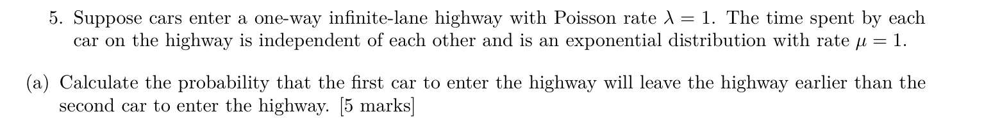

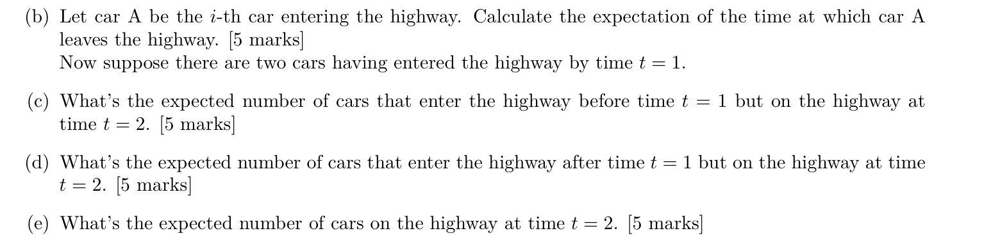

令 $N(t)$ 为进入公路的累计车数，率为 $\lambda=1$；$S_i$ 为第 $i$ 辆的进入时刻，$D_i$ 为它在路上停留的时间，$D_i\sim\operatorname{Exp}(1)$。各停留时间独立，并按本题标准模型独立于进入过程。离开时刻是 $L_i=S_i+D_i$。题面没有指定分钟或小时，以下使用题目的一般时间单位。

后半“时刻 1 前有两辆进入”按原解理解为 $N(1)=2$，不是时刻 1 路上恰有两辆，也不是至少两辆进入。两个 2023 整理版本的 (c)–(e) 答案不一致，下面始终按这个明确条件计算。

#### (a) 第一辆比第二辆更早离开的概率

##### 1. 题目在说什么

比较两辆车的离开时刻 $L_1$ 与 $L_2$。第二辆进入得较晚，但第一辆仍可能停留更久而较晚离开。问的事件是 $S_1+D_1<S_2+D_2$，不同于第一辆在第二辆进入前已离开的事件 $S_1+D_1<S_2$。

##### 2. 第一反应

先消去共同的起点 $S_1$。令第二辆与第一辆的进入间隔为 $W=S_2-S_1\sim\operatorname{Exp}(1)$，事件变为 $D_1<W+D_2$。再分成第一辆是否撑到第二辆进入的两种情形。

##### 3. 核心公式

独立同率指数竞争时 $P(D_1<W)=1/2$。在 $D_1>W$ 的条件下，指数无记忆性使第一辆剩余停留仍为率 1 的指数，并与第二辆的 $D_2$ 独立，因此两辆此后谁先离开的概率各为 $1/2$。

##### 4. 推导

若第一辆在第二辆进入前就离开，目标一定成功，概率 $1/2$。否则第二辆进入时第一辆仍在，概率 $1/2$；从这一时刻起，两辆剩余停留为独立同率指数，第一辆先离开概率 $1/2$。两个互斥分支相加：

$$
P(L_1<L_2)=\frac12+\frac12\frac12=\boxed{\frac34}.
$$

也可算补事件：

$$
P(D_1>W+D_2)=E[e^{-W-D_2}]
=E[e^{-W}]E[e^{-D_2}]=\frac12\frac12=\frac14.
$$

原卷解答承认题意曾被读为“第一辆在第二辆进入前离开”，那一事件确为 $1/2$，并曾给予分数；但两个离开时刻比较的答案是 $3/4$。这里保留这一区别，不把两个事件混写。

##### 5. 考场写法

Let $W=S_2-S_1$. Then $W,D_1,D_2$ are independent $\operatorname{Exp}(1)$ variables. Hence

$$
P(L_1<L_2)=1-P(D_1>W+D_2)
=1-E[e^{-(W+D_2)}]=1-\frac14=\frac34.
$$

##### 6. 易错点

- 将“第二辆离开”读成“第二辆进入”，会得到另一个事件的 $1/2$。
- 因两辆停留时间同分布就给 $1/2$，忽略第二辆进入较晚的时间优势。

#### (b) 第 $i$ 辆车离开时刻的期望

##### 1. 题目在说什么

$i$ 是固定的车辆序号，求从进入过程的时间原点到它离开的平均时刻。不是只求该车在路上停留多久。它先等待自身成为第 $i$ 次到达，再经历自己的停留时间。

##### 2. 第一反应

写 $L_i=S_i+D_i$。进入时刻为 $i$ 个相邻到达间隔之和，最后用期望线性性。

##### 3. 核心公式

$$
S_i=\sum_{k=1}^iW_k,\qquad E[W_k]=1/\lambda,\quad E[D_i]=1/\mu.
$$

这里 $\lambda=\mu=1$。期望相加本身不需要独立，指数与 Poisson 条件用来确定各项均值。

##### 4. 推导

率 1 的进入过程每个间隔平均长 1，所以 $E[S_i]=i$。该车停留时间均值 $E[D_i]=1$，因此

$$
E[L_i]=E[S_i]+E[D_i]=i+1=\boxed{i+1}.
$$

例如第一辆平均在时刻 1 进入，再平均停留 1，平均离开时刻为 2。

##### 5. 考场写法

Since $S_i$ is the $i$th arrival time of a rate-1 Poisson process, $E[S_i]=i$. Therefore

$$
E[L_i]=E[S_i+D_i]=i+1.
$$

##### 6. 易错点

- 回答 1，只计算了车辆进入后的停留时间。
- 将第 $i$ 次到达时刻当成恒等于 $i$；它是随机变量，只是期望为 $i$。

#### (c) 已知 $N(1)=2$，旧车中时刻 2 仍在路上的平均数

##### 1. 题目在说什么

“旧车”指在区间 $(0,1)$ 进入的两辆。已知它们进入过，并不知道时刻 1 是否仍在路上。要求其中在时刻 2 仍未离开的数量的条件期望。若某车在时刻 $u$ 进入，撑到 2 需停留超过 $2-u$。

##### 2. 第一反应

给定一个 Poisson 区间总数后，未排序到达位置是独立均匀点。对每个位置算撑到时刻 2 的概率，再乘车辆总数 2。注意按先后排序的 $S_1,S_2$ 各自并不均匀。

##### 3. 核心公式

给定 $N(1)=2$，$(S_1,S_2)$ 具有两个独立 $\operatorname{Unif}(0,1)$ 点排序后的分布。求两车指示量之和的期望是对称计算，可以用未排序的 $U_1,U_2$：

$$
P(D>2-u)=e^{-(2-u)},\qquad
E[\text{旧车数}\mid N(1)=2]
=2\int_0^1e^{-(2-u)}\,du.
$$

##### 4. 推导

先固定某个未排序到达位置为 $u$。停留时间与进入位置独立，所以留到 2 的概率为 $e^{u-2}$。位置在 $(0,1)$ 的密度为 1，平均存活概率为

$$
\int_0^1e^{u-2}\,du
=\left[e^{u-2}\right]_0^1=e^{-1}-e^{-2}.
$$

两辆车的指示量期望相加：

$$
\boxed{E[\text{旧车数}\mid N(1)=2]
=2(e^{-1}-e^{-2})\approx0.4651}.
$$

这里不需要宣称两辆的有序进入时刻独立。若坚持用有序变量，$S_1,S_2$ 的密度分别为 $2(1-u)$、$2u$，两密度之和恰为 2，也得到相同积分。

##### 5. 考场写法

Conditional on $N(1)=2$, the two unordered arrival locations are i.i.d. uniform on $(0,1)$. A car entering at $u$ is still present at 2 with probability $e^{-(2-u)}$. Thus

$$
E[\text{old cars at 2}\mid N(1)=2]
=2\int_0^1e^{u-2}\,du
=2(e^{-1}-e^{-2}).
$$

##### 6. 易错点

- 将两辆车都放在时刻 1，再乘 $e^{-1}$，忽略它们实际在 $(0,1)$ 的不同位置进入。
- 将条件误读成时刻 1 仍有两辆；题目给的是累计进入数。
- 说第一个和第二个有序到达时刻分别为独立均匀；均匀性质属于未排序点或排序后的联合分布关系。

#### (d) 时刻 1 后进入、时刻 2 仍在的平均数

##### 1. 题目在说什么

“新车”指 $(1,2)$ 内进入的车，数量不固定；时刻 2 后才进入的车不可能在时刻 2 已在路上。仍带有 $N(1)=2$ 的条件，但它属于过去区间，未来进入流与其独立。

##### 2. 第一反应

先用独立增量去掉过去条件，再条件于未来一个单位时间区间的随机到达数。这里不能像上一问直接乘 2，新车平均总数只有 1。

##### 3. 核心公式

设 $K=N(2)-N(1)$。Poisson 独立增量给 $K\sim\operatorname{Poi}(1)$，与 $N(1)$ 独立；给定 $K=k$，未排序进入位置为 $\operatorname{Unif}(1,2)$。所以

$$
E[\text{新车数}\mid K=k]
=k\int_1^2e^{-(2-u)}\,du.
$$

区间长度为 1，均匀密度仍为 1。

##### 4. 推导

一个未排序新进入位置的存活概率为

$$
\int_1^2e^{u-2}\,du
=\left[e^{u-2}\right]_1^2=1-e^{-1}.
$$

给定新车总数 $k$，在途数期望为 $k(1-e^{-1})$。再用塔式期望：

$$
E[\text{新车数}\mid N(1)=2]
=E[K](1-e^{-1})
=\boxed{1-e^{-1}\approx0.6321}.
$$

这一步用 $E[K]=1$，而非把 $K$ 固定为 1。相邻区间独立保证过去条件不改变这个值。

##### 5. 考场写法

Let $K=N(2)-N(1)\sim\operatorname{Poi}(1)$, independent of $N(1)$. Conditional on $K=k$, unordered arrivals are uniform on $(1,2)$, so

$$
E[\text{new cars at 2}\mid N(1)=2]
=E[K]\int_1^2e^{u-2}\,du=1-e^{-1}.
$$

##### 6. 易错点

- 认为已知过去进入两辆，会让未来一个单位时间也进入两辆；独立增量表示未来计数重新按原率随机。
- 把所有新车都视为时刻 1 进入，错误使用相同的存活概率 $e^{-1}$。
- “after time 1”一直积分到无穷；目标观察时刻为 2，只有此前进入的车有贡献。

#### (e) 时刻 2 路上全部车的条件期望

##### 1. 题目在说什么

目标是 $E[M(2)\mid N(1)=2]$，其中 $M(2)$ 为时刻 2 的在途车数。全部在途车唯一地分为时刻 1 前进入的旧车，以及时刻 1 后、2 前进入的新车。要求平均数量，不是“至少一辆”的概率。

##### 2. 第一反应

使用上两问的分解和期望线性性。不必另外假设旧车数、新车数独立；相加期望本身无需独立。

##### 3. 核心公式

$$
M(2)=M_{\rm old}(2)+M_{\rm new}(2),
$$

$$
E[M(2)\mid N(1)=2]
=E[M_{\rm old}(2)\mid N(1)=2]
+E[M_{\rm new}(2)\mid N(1)=2].
$$

两个子问题都要保留同一个条件。

##### 4. 推导

代入 (c)、(d)：

$$
\begin{aligned}
E[M(2)\mid N(1)=2]
&=2(e^{-1}-e^{-2})+(1-e^{-1})\\
&=\boxed{1+e^{-1}-2e^{-2}}
\approx1.0972.
\end{aligned}
$$

数值大于 1 并不矛盾，这是车辆数量的期望，可以超过 1。无条件从空路开始的时刻 2 在途均值是 $\int_0^2e^{u-2}\,du=1-e^{-2}$，不能替代本题答案；已知前半段恰两辆，比无条件平均一辆更多，条件期望相应上升。

Midterm.pdf 整理版本中 (c)–(e) 的答案未正确使用 $N(1)=2$。本专题采用与该条件一致、也与 2023_Fall_Midterm.pdf 条件积分一致的结果，不混用两份版本的数值。

##### 5. 考场写法

By linearity of conditional expectation,

$$
E[M(2)\mid N(1)=2]
=2(e^{-1}-e^{-2})+1-e^{-1}
=1+e^{-1}-2e^{-2}.
$$

##### 6. 易错点

- 使用无条件在途公式而丢掉已知到达数；条件信息会改变旧车部分。
- 只保留旧车，漏掉时刻 1 至 2 的新进入车辆。
- 将期望超过 1 当作错误；只有概率必须位于 0 与 1 之间。
